# Digital Autonomy, Open Source, and AI

> Research report behind the oSTEM 2026 workshop *Every App Is an Argument* (presented Saturday, October 24, 2026). Published as written for the talk; facts are as of the evidence cutoff below. "Your notes" and "you" refer to the presenter.

**Final research report for the oSTEM 2026 workshop**

Evidence cutoff: **October 21, 2026** · Phase: Research (supersedes the "Aggregate Research" PDF) · Figures: the lavender versions used in the deck, in [`slides/public/graphics-lav/`](../slides/public/graphics-lav/)

---

## How to read this report

This report merges four inputs into one document: the Aggregate Research PDF [1], the four papers you collected [2, 3, 4, 5], your Notes and project brief [6, 7], and the oSTEM speaker kit [8]. On October 21, 2026, every claim the aggregate labeled "Inherited" or "Open question," and the key claims inside the four papers, were checked against primary sources: the organization's own report, the court or regulator document, the official license file, or the peer-reviewed paper.

Every claim carries one of these labels:

| Label | Meaning |
|---|---|
| **[Verified]** | Checked against a primary source on Oct 21, 2026 |
| **[Corrected]** | The aggregate or a paper had it wrong or out of date; the corrected value is given |
| **[Secondary]** | Only a news or secondary source could be reached; attribute it on a slide |
| **[Open]** | Could not be verified; keep it off slides or say it's unconfirmed |
| **[Framing]** | Workshop interpretation or proposed wording, not an empirical finding |

Section 14 lists every item that changed from the aggregate. Section 15 lists what is still open. Figures are referenced inline; each image's full alt text, source and data table are in [`graphics.md`](graphics.md) and [`data/`](../data/).

---

## 0. Executive summary

### Twelve findings that survived verification

1. **App membership itself is sensitive data, and regulators have said so.** Norway fined Grindr NOK 65 million for sharing user data, including the fact of using Grindr, with advertisers without valid consent. An appeals board and two courts upheld it, most recently the Court of Appeal on Oct 21, 2025. In October 2026 (decision Oct 2, announced Oct 12), Norway also fined the ad-tech firm Xandr NOK 92 million over the same data flows [9, 10]. [Verified]
2. **U.S. location-data orders named LGBTQ+ places, then stopped.** FTC orders against X-Mode (2024), Gravy Analytics and Mobilewalla (2025) addressed LGBTQ+-serving locations [11, 12, 13]. [Verified] Law-firm analyses of the 2026 Kochava settlement report that its sensitive-location list does not [14, 15]. [Secondary]
3. **"Who owns this data?" is the wrong legal question. "Who can use it, and could I leave?" is the right one.** Terms almost always grant a *license*, not ownership. GitHub's April 2026 terms explicitly license GitHub and Microsoft to train AI on your content, and the opt-out does not cover public repositories [16]. [Verified]
4. **Defaults decide more than quality does.** A federal court found Google paid $26.3 billion in 2021 to be the default search engine, and that users "rarely" switch defaults [17]. [Verified; on appeal]
5. **AI systems have a documented pattern of misreading queer people.** About 95% of automatic gender recognition papers treated gender as binary [18]. A moderation AI rated many drag queens' accounts as more "toxic" than white nationalist leaders' [19]. A widely used training-corpus filter was more likely to discard text mentioning sexual orientations than text mentioning racial or ethnic identities [20]. [Verified]
6. **The evidence on AI built *for* LGBTQ+ people is thin.** A scoping review found 9 studies covering 7 apps, mostly small and short [3]. [Verified]
7. **LGBTQ+ people are more skeptical of AI, not less informed.** LGBTQ+ young people were more likely than cisgender and straight peers to expect AI to hurt their lives (28% vs 17%) [21]. Among U.S. adults who don't use chatbots, 79% cite concern about personal information [22]. [Verified]
8. **Productivity is real for some tasks and absent or negative for others.** Measured gains include 40% less time on short writing tasks and 15% more issues resolved per hour in customer support. Experienced developers in early 2025 were measured 19% *slower* while believing they were 20% faster [23, 24, 25]. [Verified; METR updated in 2026]
9. **Verification is where AI output becomes trustworthy, but it checks correctness, not meaning.** 48% of developers trust AI output "when I can easily verify" it [26]. Lean-checked math proofs are machine-verified, but a checker confirms a proof matches its formal statement, not that the statement was the right one [27]. In a separate DeepMind evaluation, an AI agent's own verifier marked 212 answers correct; experts judged 63 technically correct and only 13 "meaningfully correct" [28]. [Verified]
10. **"Open" AI has four levels, and most famous "open" models are open weights with custom licenses.** Only a few model families release weights, code and training-data information, such as OLMo [29, 30]. Gemma 4 moved to Apache-2.0 in April 2026 [31]. [Verified]
11. **The software shortlist mostly holds, with notable changes.** GPT4All looks stale, Open WebUI is no longer OSI open source, LM Studio and Msty are proprietary, and Logseq is mid-split. Codeberg's 2026 terms now turn away LLM-heavy projects [32, 33, 34, 35]. [Verified]
12. **Popularity signals can be faked.** Researchers flagged about 6 million suspected fake GitHub stars, and at the July 2024 peak, 1 in 6 popular repos had fake-star campaigns [36]. [Verified]

### The corrections that matter most for slides

| Aggregate or paper said | Verified status |
|---|---|
| Sonatype: 9.8T downloads, "+67%" (and 6.6T in 2024) | 9.8T confirmed. "67%" appears only in the press release and can't be reproduced. 6.6T to 9.8T is about +48%. Don't pair them [37, 38]. |
| GitHub: "~60% of fastest-growing projects AI-focused" | Actually "6 of the 10 fastest-growing repositories were AI infrastructure projects" [39]. |
| Brynjolfsson: 5,172 agents, ~15% | QJE version: 5,172 agents, +15%. The 5,179 / 14% / 34% figures are the 2023 working paper [24, 40]. |
| METR 2025 slowdown as a current fact | Early-2025 snapshot. METR's Feb 2026 update suggests speedups now, but inconclusively [41]. |
| Copilot: training opt-out, 18-month history | Describes the *older* app. The new app (Aug 18, 2026) says chats aren't used to train foundation models, but ads can use chat history [42, 43]. |
| ChatGPT policies "not rechecked" | Ads began as a U.S. test on Feb 9, 2026 (Free and Go plans) and now run in 89 countries; with personalization on they can use past chats [44, 45]. |
| Claude: 5 years vs 30 days | Confirmed; the 5 years applies to de-identified data in training pipelines [46]. |
| Element moved to AGPL in 2023 | 2023 covered servers only. The apps moved under a Sept 2024 post [47]. |
| EU AI Act Art. 10(5) (Fosch-Villaronga & Malgieri) | Deleted July 2026 and replaced by a broader Art. 4a; high-risk deadlines moved to Dec 2027 and Aug 2028 [48]. |
| "LGBTQ people almost 3x more likely to experience depression, anxiety, suicidal thoughts" (Bragazzi) | About right for youth suicidality (41% vs 13%), overstated for adult depression and anxiety (about 1.5–2.6x) [49, 50]. |
| "Thiago, Marcelo & Gomes" (drag queen study, in Fosch-Villaronga & Malgieri) | Authors are Dias Oliva, Antonialli & Gomes [51]. |
| Trevor Project simulator: both personas early-20s Californians (Bragazzi) | Riley is a North Carolina teen; Drew is the early-20s Californian. ">1,000 counselors" dates from Dec 2021 [52]. |

### Five things to say carefully on stage

1. **Legal cases:** say what happened and its status ("a court found…", "settled without admission", "can still be appealed"). The kit says oSTEM, as a 501(c)(3), may not support or condemn political candidates and is limited in advocating for or against legislation, and that presenters may count as its representatives [8]. Reporting laws and rulings neutrally keeps you well inside that. [Framing]
2. **Survey denominators:** Pew's "42% use chatbots to search" is of *all* adults; among chatbot users it's 86% [53]. [Verified]
3. **Local AI is not a legal shield.** Say "a correctly configured local workflow can avoid sending prompts to a model provider," not "nothing can be subpoenaed." [Framing]
4. **Open source is a practical choice, not a purity test.** Several tools in this report are excellent but not open source (Obsidian, LM Studio); say so plainly. [Framing]
5. **Mental-health statistics need a content warning** and a crisis resource on screen. Frame disparities as effects of stigma and minority stress, not identity [49]. [Framing]

### One timely hook

**oSTEM and Queer in AI jointly run a graduate-school application fee aid program** (up to US$750 per applicant). The 2026/27 round closes **November 3, 2026**. Queer in AI reports 160 recipients and about $128K paid in earlier rounds [54, 55]. [Verified] It's a direct, concrete link between queer AI ethics and your audience.

---

## 1. Scope, audience, and standards

### 1.1 The talk

A 60-minute interactive workshop at the oSTEM Annual Conference (Albuquerque, programming from Thursday, Oct 22, 2026). The conference expects about 1,100 participants and up to eight concurrent sessions; one session can draw 100 or more people. Rooms use round tables, so small-group activity works [8]. The audience is college students with mixed technical backgrounds [7].

Attendee goals from the brief [7]:

1. Name which apps hold their most sensitive data and who controls that data.
2. Swap at least one proprietary tool for an open source alternative.
3. Judge whether a GitHub project is trustworthy and maintained.
4. Leave with access to the discovery tool and one concrete next step.

Section map, following the time budget:

| Minutes | Segment | Report sections | Graphics folder |
|---|---|---|---|
| 0–5 | Hook and who I am | 5, 0 | `01-hook-ai-context` |
| 5–10 | Why digital autonomy matters; rhetoric of tech | 2, 3 | `02-why-autonomy-matters` |
| 10–15 | Queer AI ethics | 4 | `03-queer-ai-ethics` |
| 15–20 | Guided software audit | 2.10, 8.1 | `04-software-audit` |
| 20–45 | Alternatives: local AI, secure communication, art, organization | 6, 7, 8, 9 | `05-alternatives-and-local-ai` |
| 45–53 | Navigating GitHub to vet OSS | 10 | `06-vetting-and-github` |
| 53–57 | Discovery tool | 11 | `07-discovery-tool` |
| 57–60 | Wrap-up and next step | 0 ("One timely hook"), 13 | — |

### 1.2 Presenter obligations from the speaker kit

The kit asks presenters to avoid sales pitches, follow the posted session description, stay relevant to the LGBTQ+ community, use non-binary language, and give content warnings before the workshop starts [8]. Two parts of this report need a content warning: Section 2.5 (arrests and entrapment) and Section 4.7 (mental health and suicide statistics).

The kit's political guidance: oSTEM, a 501(c)(3), may not support or condemn a political candidate nor, in general, advocate for or against legislation with more than 20% of its financial resources. The restriction covers candidates and legislation, not advocacy for a cause by non-political figures, and presenters "are a representative of oSTEM, Inc. in some capacity" [8]. To stay comfortably within it, this report reports laws, court rulings and advocacy statements neutrally, with attribution. [Framing]

### 1.3 Research standards

The brief requires every claim about how a company handles data to have a cited source, and queer-specific risks to be concrete and sourced, never speculative [7]. This report follows that rule. Where a fact could only be found in a secondary source it is labeled, and where it couldn't be verified it is listed in Section 15 rather than presented.

---

## 2. Why digital autonomy matters for queer people

The pragmatic case is not "every app is dangerous." It's that **some data reveals who you are even when you never typed it**, and once it leaves your control, other people's decisions govern it. The cases below are documented, dated, and sourced. They show mechanisms, not prevalence.

### 2.1 Being on an app is itself sensitive

*Figure 1. Grindr data case timeline. Source: Datatilsynet; Forbrukerrådet; Grindr 8-K. *

**Grindr in Norway.** In January 2020 the Norwegian Consumer Council (Forbrukerrådet) complained about Grindr and five ad-tech companies, including AppNexus, now Xandr [56]. On Dec 15, 2021, Norway's data protection authority, Datatilsynet, fined Grindr **NOK 65 million** (about €6.5M at the time), down from a proposed NOK 100 million [9]. [Verified]

- Grindr shared users' GPS location, IP address, advertising ID, age, gender, and the fact that they used Grindr with advertising partners, without valid consent.
- The regulator held that being identifiable as a Grindr user is special-category data revealing sexual orientation under GDPR Article 9.
- The Privacy Appeals Board upheld the fine in September 2023, the Oslo District Court on July 1, 2024, and the Borgarting Court of Appeal on **October 21, 2025** [9, 57]. The appeals court found consent invalid because users had to accept the policy to use the app.
- Whether Grindr sought Supreme Court review is not documented in sources reached. **Don't call the fine "final."** [Open]

**Xandr in Norway (new, October 2026).** On Oct 2, 2026 (announced Oct 12), Datatilsynet fined **Xandr Inc.**, an ad-tech firm Microsoft now owns, **NOK 92 million** (about €8.5M), its largest fine to date [10, 58]. [Verified via complainant and secondary reports; Datatilsynet's page blocked automated fetching]

- Through real-time ad auctions, Xandr received and passed on Grindr users' data, including the app name, advertising ID and IP address, from July 2018 to April 2020.
- Datatilsynet found Xandr was a joint controller with no legal basis, and rejected the argument that it could rely on Grindr's consent: actors cannot "simply blame one another."
- Xandr can appeal. Microsoft said it is "reviewing the decision" and that the conduct predates its acquisition.

**Related but distinct:**

- In 2018, researchers commissioned by Swedish broadcaster SVT found Grindr sent users' HIV status and last-tested date to two app-optimization vendors, Apptimize and Localytics. Grindr said it would stop [59]. [Verified]
- A UK group claim over pre-2020 sharing, including HIV status, **settled on Sep 2, 2026 for £26 million, with no admission of liability** [60]. [Verified]
- The Markup's 2023 analysis of about 650,000 Xandr audience segments found **political-issue** LGBTQ segments ("LGBTQ Advocacy," "Marriage Equality Opposition"), not explicit sexual-orientation segments [61]. Don't claim it found "gay user" segments. [Verified]

**Workshop line [Framing]:** "Norway's regulator treated the mere fact that you use Grindr as data that reveals your sexual orientation. An appeals board and two courts agreed."

### 2.2 Location data and data brokers

*Figure 2. FTC location-data orders and LGBTQ+ places. Source: FTC (2024–2026). *

Phones generate location trails; brokers buy and resell them. U.S. enforcement has come through FTC orders, and the orders differ in whether they name LGBTQ+ places [Verified]:

| Order | Final | LGBTQ+ language? | What it does |
|---|---|---|---|
| X-Mode / Outlogic | Apr 12, 2024 | Yes | Bans selling sensitive location data; requires procedures so recipients don't link data to "locations that provide services to LGBTQ+ people" such as bars or service organizations [11] |
| InMarket | May 1, 2024 | No | Bans selling or licensing *any* precise location data [62] |
| Gravy Analytics / Venntel | Jan 14, 2025 (5–0) | Yes, in a separate part | Main sensitive-location list covers medical, religious, correctional, union, childcare and similar sites. Part IV separately covers LGBTQ+-serving places such as bars and service organizations, plus protests [12] |
| Mobilewalla | Jan 14, 2025 (4–1) | Yes | Lists "LGBTQ+-related locations" among sensitive locations; first FTC allegation that keeping ad-auction bid data was unfair [13] |
| Kochava | Announced May 4, 2026; reportedly entered Jun 25, 2026 [Secondary] | No, per law-firm analyses [Secondary] | Bans sale of sensitive location data without consent; narrower sensitive-location list; no money [14, 15] |

**Workshop line [Framing]:** "Between 2024 and January 2025, three FTC orders specifically protected location data tied to LGBTQ+ places. The 2026 Kochava settlement uses a narrower list." State that comparison factually; don't characterize why it changed.

**A reported consequence.** On July 20, 2021, The Pillar published a report, reportedly based on commercially available app-signal data, linking a device to a senior Catholic official and to Grindr use; he resigned the same day [63]. [Date and resignation verified; methodology Open, as the article is paywalled]

**State law.** Washington's My Health My Data Act explicitly treats "gender-affirming care information" and "reproductive or sexual health information" as consumer health data, bans geofencing within 2,000 feet of in-person health-care providers, and gives consumers a private right of action [64]. [Verified] Reports that Virginia and Connecticut restricted the sale of precise location data in 2026 come from law-firm summaries; check the legislatures' records before presenting. [Secondary]

### 2.3 Health and reproductive data

The FTC alleged that Flo Health's fertility-tracking app sent data, including whether a user was pregnant, to analytics divisions at Facebook and Google and others, despite promising privacy. Its 2021 final consent order requires affirmative consent before sharing health data; no money was paid [65]. [Verified]

The related class action (*Frasco v. Flo Health*) reportedly produced settlements and, in August 2025, a jury verdict against Meta under the California Invasion of Privacy Act; these details weren't re-verified [Open]. **The 2026 status of damages, judgments and appeals could not be verified** [Open]. Use the FTC finding as the anchor.

### 2.4 Records held by others can be requested by government

Medical and other records you don't hold yourself can be sought by subpoena, and courts decide whether to enforce them. The aggregate's references to Department of Justice subpoenas to providers of gender-affirming care (announced July 2025, "more than 20") and to a September 2025 ruling quashing one at Boston Children's Hospital **could not be re-verified from primary sources this session** [Open]. Present this as a general privacy lesson, not as a specific case, until the dockets are checked.

### 2.5 When apps become evidence (content warning)

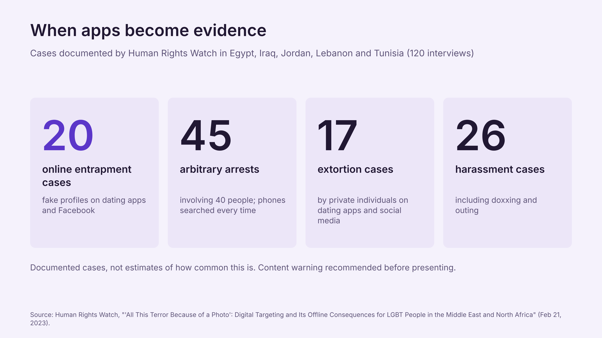

*Figure 3. Human Rights Watch digital targeting cases. Source: Human Rights Watch (2023). *

Human Rights Watch's 2023 report on Egypt, Iraq, Jordan, Lebanon and Tunisia drew on 120 interviews, including 90 with LGBT people affected by digital targeting [66]. It documented [Verified]:

- **20 cases of online entrapment** on Grindr and Facebook (Egypt, Iraq, Jordan); 16 of those people were arrested.
- **45 cases of arbitrary arrest involving 40 people**; security forces searched the person's phone every time.
- **17 cases of extortion** on dating apps and social media.
- **26 cases of online harassment**, including doxxing and outing.

These are documented cases, not prevalence estimates. ARTICLE 19 separately documented Egyptian arrests in 2017, many through dating-app entrapment, after a rainbow flag was raised at a concert [67]. [Verified]

### 2.6 Moderation and platform policy

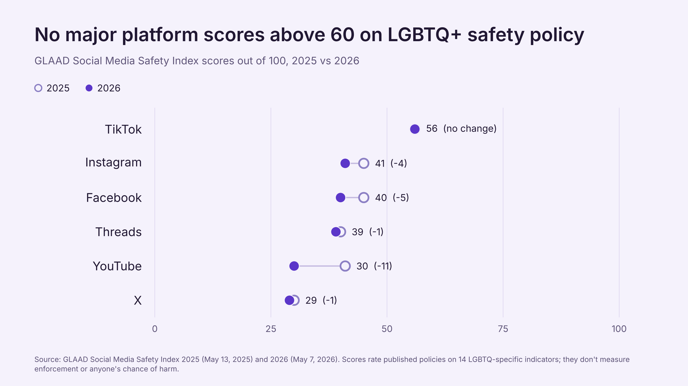

*Figure 4. GLAAD Social Media Safety Index 2025–2026. Source: GLAAD SMSI 2025, 2026. *

GLAAD's Social Media Safety Index scores platforms out of 100 on 14 LGBTQ-specific indicators of *published policy*. It does not measure enforcement or anyone's probability of harm [68]. [Verified]

| Platform | 2025 | 2026 |
|---|---|---|
| TikTok | 56 | 56 |
| Instagram | 45 | 41 |
| Facebook | 45 | 40 |
| Threads | 40 | 39 |
| YouTube | 41 | 30 |
| X | 30 | 29 |

The 2025 method was new, so 2025 isn't comparable to earlier years [69].

Specific policy texts [Verified unless noted]:

- **Meta (Jan 7, 2025):** the Hateful Conduct policy now says it allows "allegations of mental illness or abnormality when based on gender or sexual orientation" [70, 69]. GLAAD's 2026 index says this continues.
- **YouTube:** GLAAD reports that YouTube removed "gender identity and expression" from its public hate-speech list in early 2025. YouTube says its policies haven't changed [69]. Present it as disputed.
- **X:** GLAAD says X prohibits targeted misgendering and deadnaming only "where required by local laws" [68]. [Secondary to X's own page]

### 2.7 "Anonymous" data often isn't

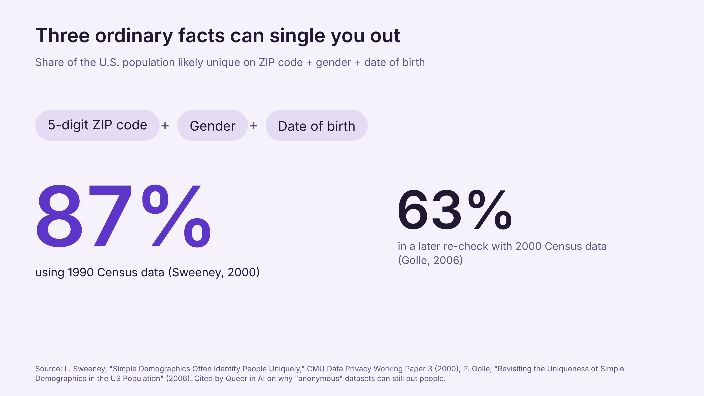

*Figure 5. Re-identification from three facts. Source: Sweeney (2000); Golle (2006). *

Latanya Sweeney estimated that 87% of the U.S. population was likely unique on five-digit ZIP code, gender and date of birth, using 1990 Census data [71]. A later re-check with 2000 Census data found 63% [72]. [Verified] Queer in AI cites this to explain why small, "anonymized" queer datasets can still identify people [5].

### 2.8 Age verification and access

These are contested policy areas; report facts and attribute positions [8].

- **UK:** Ofcom's child-safety codes require "highly effective age assurance" on pornography sites and the riskiest services from July 25, 2025 [73]. [Verified]
- **U.S.:** In *Free Speech Coalition v. Paxton* (June 27, 2025, 6–3), the Supreme Court applied intermediate scrutiny and upheld Texas's age-verification law for sexual content, noting "at least 21 other States" had similar laws [74]. [Verified]
- **Australia:** a minimum age of 16 for major social platforms took effect Dec 10, 2025 [75]. [Secondary]
- **Breach risk:** Discord said about 70,000 users' government-ID photos may have been exposed through a third-party support vendor that handled age-related appeals (Oct 2025) [76]. [Verified]
- **LGBTQ+ organizations' position:** a March 24, 2026 coalition statement led by LGBT Tech and signed by groups including The Trevor Project and GLAAD opposes age-minimum social-media bans, arguing online spaces are "among the first or only accessible sources of identity-affirming community" [77]. EFF has raised similar concerns [78]. Attribute these; don't endorse or oppose specific bills.

### 2.9 App availability depends on local law

Grindr's own help page lists eight countries, including China and Saudi Arabia, where it is delisted from the app store, and others where it is government-restricted [79]. [Verified; self-reported and undated] When one company's store is the only way to install software, local law decides what is available. Sideloading and open-source app stores (such as F-Droid on Android) are relevant here.

### 2.10 What these cases do and don't establish

They show concrete pathways: app membership as a sensitive signal, ad auctions moving data, brokers reselling location, platform policy shifts, and records sought by others. [Framing]

They do **not** show that every proprietary app is dangerous, or that open source automatically fixes these problems. An open-source app can still send data to a cloud service; a proprietary app can be carefully designed. That's why the audit asks two questions about *control and exit*, not about brand.

**Audit wording that stays accurate [Framing]:**

- Who can access or process this information?
- Where is it stored?
- Can I export and delete it?
- What happens if the provider changes its terms or shuts down?

*Figure 6. Software audit matrix. Source: Workshop framework (interpretation). *

**Resources to hand out:**

- EFF Surveillance Self-Defense "LGBTQ Youth?" guide: threat-model questions, social-network safety, Signal [80].
- GLAAD LGBTQ Digital Safety Guide (updated June 2026): password managers, authenticator-app 2FA, data-broker opt-outs, doxxing playbook [81].
- Tactical Tech's Data Detox Kit for everyday steps [82].
- Access Now's Digital Security Helpline serves at-risk civil society; individuals may not qualify [83].

---

## 3. Technology rhetoric: why popular isn't the same as best for you

The brief asks you to teach "how good arguments dictate software usage… not because the tools themselves are better or worse" [7]. The evidence for that is strongest in court records about defaults and in regulators' cases about "dark patterns."

*Figure 7. Six forces behind software popularity. Source: Workshop framework. *

### 3.1 Defaults are bought

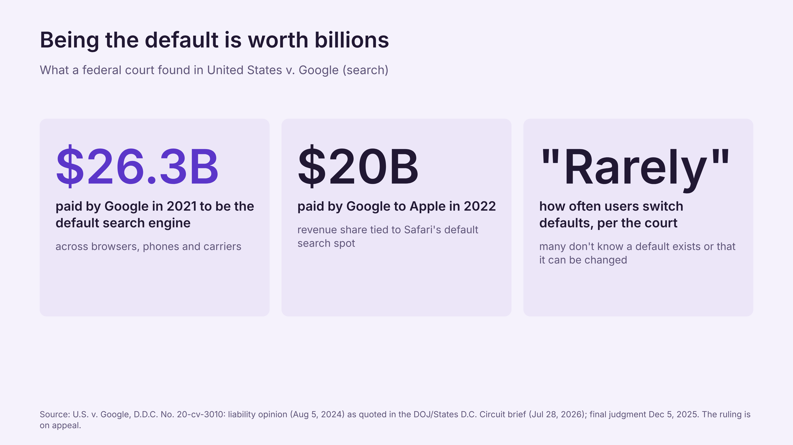

*Figure 8. Defaults are paid for. Source: U.S. v. Google (D.D.C.). *

In *United States v. Google*, the court found Google paid distributors **$26.3 billion in 2021** under default-placement contracts; Apple alone received about **$20 billion in 2022** [17]. [Verified] The liability opinion also found:

- users can switch defaults, but "the market reality is that users rarely do so";
- "many users do not know that there is a default search engine, what it is, or that it can be changed."

Status [Verified]: liability ruling Aug 5, 2024; remedies Sept 2, 2025 (no Chrome or Android divestiture; exclusive contracts banned; some data sharing with competitors) [84]; final judgment Dec 5, 2025 (six-year term; default deals limited to one year) [85]. Cross-appeals are pending in the D.C. Circuit. Say "a federal court found."

### 3.2 Interfaces nudge

- **Amazon Prime (FTC, Sept 25, 2025):** $2.5 billion settlement ($1 billion civil penalty plus $1.5 billion in refunds to about 35 million consumers) over enrolling people without consent and making cancellation hard [86]. [Verified; settlement of allegations]
- **Epic Games (FTC, Dec 2022):** $245 million in refunds over "counterintuitive, inconsistent, and confusing button configuration" in Fortnite, alongside a separate $275 million children's-privacy penalty [87]. [Verified]
- The FTC's "click-to-cancel" rule was vacated by the Eighth Circuit on July 8, 2025 on procedural grounds, not on the merits [88]. [Verified]

### 3.3 Network effects and switching

When WhatsApp announced a privacy-policy update in January 2021, it delayed it after "so much confusion" [89]. Telegram claimed over 100 million new users that month [90] [company claim], and Signal saw a sign-up surge that overwhelmed its verification texts [Secondary]. **Lesson [Framing]:** people *will* switch when a reason is clear and their friends move too, which is why the audit's "could I leave?" question matters.

### 3.4 License vs ownership

- **Mozilla Firefox (Feb 2025):** after backlash, Mozilla revised its first Terms of Use to say users grant "a nonexclusive, royalty-free, worldwide license for the purpose of doing as you request with the content you input in Firefox. This does not give Mozilla any ownership in that content" [91]. The current terms took effect Sept 16, 2026 [92]. [Verified; the original Feb 2025 wording could not be confirmed from Mozilla's pages]
- **GitHub (April 2026):** see Section 10.6. The license you grant is broad enough to cover AI training [16]. [Verified]

**Workshop line [Framing]:** "Most apps don't own your data. They hold a license to use it, and that license can be broad enough to train AI."

---

## 4. Queer AI ethics

This section synthesizes the four papers you collected with the foundational studies they cite, checked against the originals.

### 4.1 The four papers at a glance

| Paper | What it argues | Strongest evidence it brings | How to use it | Corrections |
|---|---|---|---|---|
| **Fosch-Villaronga & Malgieri, "Queering the ethics of AI"** (book chapter, 2024) [2] | AI ethics built on fixed binary categories (engineering's "works/doesn't work" dualism, binary sex/gender, closed lists of protected groups) fails queer and intersectional lives. Proposes "vulnerability-sensitive design," participatory design, ethical impact assessments, and actionable algorithmic audits. | Cites Keyes on misgendering, Gender Shades, drag-queen moderation, unrepresentative datasets, and the EU AI Act's bias-data provision. | The conceptual frame for "why categories matter." Its point that *human review* can make things worse (e.g., airport body scanners flagging trans travelers) is memorable. | Drag-queen study authors are misnamed (Section 4.5). The EU AI Act provision it discusses has since been replaced (Section 4.6). |
| **Bragazzi et al., JMIR scoping review** (2023) [3] | Generative conversational AI could support LGBTQ people (anonymity, 24/7 access, tailored information) but risks bias, privacy harm and "depersonalization of support." | 1,390 records found, 1,181 screened, 9 studies and 7 apps included; stakeholder checklist co-designed with LGBTQ organizations. | Shows how *thin* the evidence base is, and lists concrete development recommendations. | "Almost 3 times more likely" needs qualifying (Section 4.7); persona description of the Trevor Project simulator is wrong (Section 4.8). |
| **Jędrusiak, "Queering AI as a Speculative Practice"** (HT '24) [4] | Bias-fixing may never escape the normativity of categorization; queer artists instead use AI speculatively to imagine fluid, non-categorical systems. | Analyses *Zizi – Queering the Dataset*, *Mutant in the Mirror*, QT.bot / *Queering the Map*, and *Ultimate Fantasy* / Queer AI. | Gives the creative, hopeful counterpoint, and fits the studio-art segment. Notes honestly that queering "is not currently a viable remedy for algorithmic oppression." | Minor: misspells the artist as "Jack Elwes." |
| **Queer in AI, "Rebuilding Trust"** (2021 position paper) [5] | Trustworthy AI requires non-exploitative participatory design, independent monitoring, and shifting power; some tasks (detecting sexuality or gender from faces) should never be automated. | Queer in AI's own 2021 member survey (n = 142); Wikipedia pronoun counts; C4 filtering; Sweeney re-identification; concrete privacy practices. | The most practical and community-rooted of the four. Queer in AI partners with oSTEM on grad-application aid. | Rekognition matches were to mugshots, not "criminals." The paper is a 2021 arXiv position paper; a formal NIST filing could not be confirmed. |

A fifth piece you saved, Katrin Köppert's "Queersplaining AI" (Heinrich-Böll-Stiftung EU, May 28, 2024), is a commentary with no statistics. It argues that "explainability" should expose AI's contradictions and power structures rather than promise a universal fix, and proposes "AI for some" instead of "AI for all" [93]. [Verified] Cite it for framing, not evidence.

### 4.2 Three mechanisms to keep separate

The aggregate recommended keeping these distinct [1]. The verified evidence supports that structure. [Framing]

1. **Classifying people in ways that don't fit them** (binary, fixed, physiological categories).
2. **Inferring sensitive attributes without consent** (sexual orientation or gender from faces, behavior or app use).
3. **Representation and moderation** (queer language under-represented in training data, filtered out, or flagged as harmful).

### 4.3 Mechanism 1: categories that don't fit

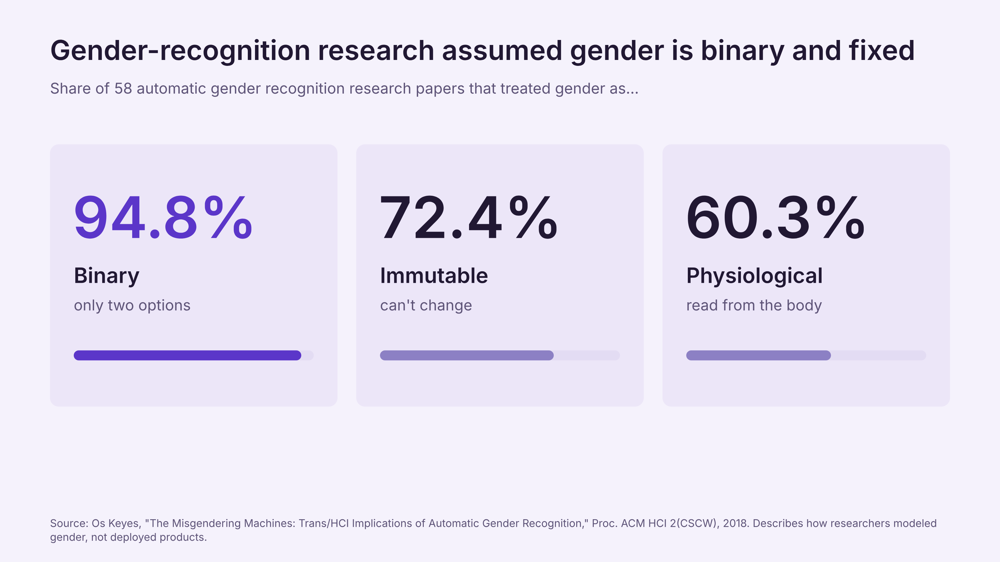

*Figure 9. How gender-recognition research modeled gender. Source: Keyes (2018), CSCW. *

- **Keyes (2018)** reviewed **58 automatic gender recognition papers**: **94.8%** treated gender as binary, **72.4%** as immutable, and **60.3%** as physiological [18]. [Verified] This describes how researchers modeled gender, not the accuracy of deployed products.
- **Gender Shades (2018):** three commercial gender classifiers had error rates up to **34.7% for darker-skinned women** versus at most **0.8% for lighter-skinned men** [94]. [Verified] The classifiers only allowed two genders, so they could never be right about non-binary people. Vendors updated their systems after publication.

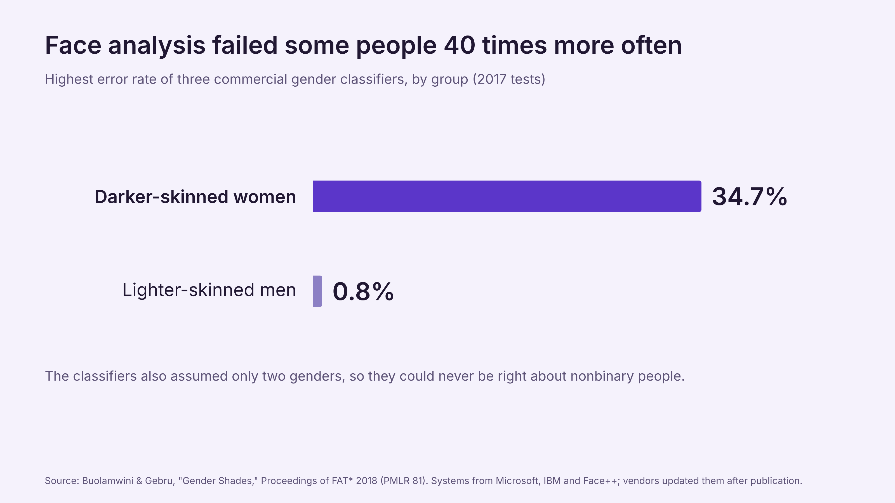

*Figure 10. Gender Shades error rates. Source: Buolamwini & Gebru (2018). *

- **Historical misclassification** cited by Queer in AI: Google Photos labeled Black people "gorillas" in 2015 and "fixed" it by blocking the label; in 2018 the ACLU found Amazon Rekognition falsely matched 28 members of Congress to mugshots, nearly 40% of them people of color versus 20% of Congress, including six Congressional Black Caucus members; in 2021 Facebook's AI prompted "Keep seeing videos about Primates?" on a video of Black men [95, 96]. [Verified] These are race, not queer, examples; they illustrate Fosch-Villaronga & Malgieri's intersectionality point.

### 4.4 Mechanism 2: inferring what people never disclosed

- **Wang & Kosinski (2018)** claimed a classifier could distinguish gay from straight faces in 81% of cases for men and 74% for women from one photo (91% and 83% with five), using 35,326 dating-site images [97]. [Verified]
  - Caveats: as commonly described, the figure comes from choosing which of two faces was gay, not labeling real people (not re-read in the paper this session); critics noted the dataset excluded non-white people [98].
  - Critics showed the model picked up grooming and photo conventions (makeup, glasses, facial hair, selfie angle) rather than facial structure [99]. GLAAD and HRC warned in a joint statement that "technology cannot identify someone's sexual orientation" [98]. [Secondary]
- **Queer in AI's position:** "even a participatory approach is not appropriate for the design of a sexuality detection system; no amount of input from diverse queer participants can compensate for the reality that the premise of the system is based in physiognomy" [5]. The same applies to systems that claim to detect trans or non-binary identity. [Verified]
- This connects directly to Section 2: Norway's regulators treated app *membership* as revealing sexual orientation, which is inference by association [9].

### 4.5 Mechanism 3: representation, filtering, and moderation

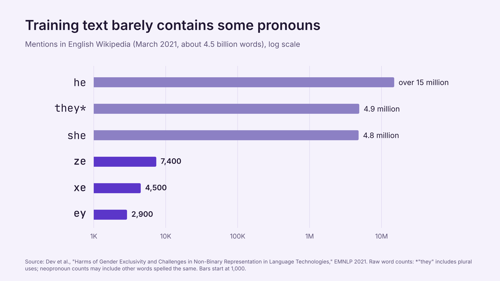

*Figure 11. Pronoun mentions in English Wikipedia. Source: Dev et al. (2021), EMNLP. *

- **Who appears in training text.** In a March 2021 English Wikipedia dump (about 4.5 billion tokens), "he" appeared over 15 million times, "she" 4.8 million, "they" 4.9 million (mostly plural), and the strings "ze" 7,400, "xe" 4,500 and "ey" 2,900 [100]. [Verified] These are raw string counts, and most "xe" and "ze" hits weren't even pronouns (they referred to a company and to the Polish word for "that") [5], so actual neopronoun use is rarer still.
- **What gets filtered out.** Documenting Google's C4 corpus, Dodge et al. found its blocklist filter "disproportionately removes text from and about minority individuals," and that "mentions of sexual orientations (lesbian, gay, heterosexual, homosexual, bisexual) have the highest likelihood of being filtered out, compared to racial and ethnic identities" [20]. [Verified] A Queer in AI organizer is a co-author.
- **What gets flagged.** In 2019, Google's Perspective API scored **80 drag queens'** Twitter accounts (114,204 tweets) at average toxicity between **16.68% and 37.81%**, versus **21.30%–28.87%** for four white nationalist figures and **21.84%** for Donald Trump. A significant number of drag queen accounts scored higher than the white nationalists'; the tool couldn't read in-group humor and reclaimed language [19, 51]. [Verified] Note the correct authors: **Dias Oliva, Antonialli & Gomes** (Fosch-Villaronga & Malgieri cite them as "Thiago, Marcelo & Gomes"). [Corrected]
- **Related dialect bias:** hate-speech detectors flagged tweets in African American English up to twice as often as offensive [101]. [Verified]

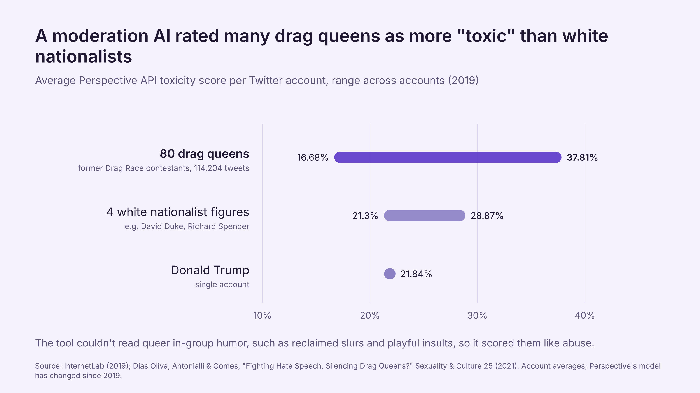

*Figure 12. Moderation AI and drag queens' tweets. Source: InternetLab (2019); Dias Oliva et al. (2021). *

### 4.6 Data, privacy, and the inclusion paradox

Queer in AI names the bind: fairness methods usually want *more* data about sexual orientation and gender, but collecting it exposes queer people to "predatory inclusion," privacy risk, and potential violence. Quoting Tomasev et al., it notes sexual orientation and gender identity are "frequently missing, unknown [for privacy reasons] or fundamentally unmeasurable" [5]. [Verified]

**Practices Queer in AI uses for its own data** (useful as a model for your discovery tool and any survey you run) [5]:

- sign-up forms for social events;
- anonymous publication options;
- survey data stored separately with restricted access;
- only aggregated statistics released, never raw or "suppressed" versions.

**EU AI Act: the rule Fosch-Villaronga & Malgieri discussed has changed.** [Corrected]

- The chapter quoted the 2021 *proposal* of Article 10(5), which would let high-risk AI providers process special-category data (including sexual orientation) strictly to detect bias.
- The enacted Act (Regulation 2024/1689, in force Aug 1, 2024) included it with conditions: necessity, technical limits on reuse, restricted access, no transfer, deletion, and records [102].
- The "Digital Omnibus" (Regulation 2026/1744, in force July 27, 2026) **deleted Article 10(5)** and moved it into a new **Article 4a** that also lets providers and deployers of *other* AI systems process such data exceptionally for bias detection. It "does not create any obligation" to do so. Most high-risk obligations were postponed to **Dec 2, 2027** and **Aug 2, 2028** [48]. [Verified; postponement dates from the recitals and Commission page]
- Present this neutrally as a change in how the law handles the inclusion paradox.

### 4.7 Mental-health context (content warning)

Bragazzi et al. open by stating that LGBTQ people are "almost 3 times more likely to experience depression, anxiety, and suicidal thoughts" [3]. That holds for **youth suicidality** but overstates the gap for adult depression and anxiety. [Corrected] Use these instead, as aggregate statistics only, with a crisis resource on screen:

| Source | Population | Measure | Value |
|---|---|---|---|
| CDC YRBS 2023 [49] | U.S. high schoolers, LGBQ+ vs heterosexual | Seriously considered suicide | 41.0% vs 13.0% (about 3.2x) |
| | | Attempted suicide | 19.7% vs 6.0% |
| | | Persistent sadness or hopelessness | 65.7% vs 31.4% |
| CDC YRBS 2023 [103] | Transgender vs cisgender students | Seriously considered suicide | 52.9% vs 24.0% (cis female), 12.1% (cis male) |
| Trevor Project 2025 survey (released May 6, 2026) [104] | 16,000+ LGBTQ+ people aged 13–24 | Seriously considered suicide in past year | 36% (40% trans/non-binary, 26% cis) |
| | | Attempted suicide | 10% |
| | | Of those who wanted mental health care, couldn't get it | 44% |
| King et al. 2008 meta-analysis [50] | LGB adults | Depression and anxiety, relative risk | about 1.5–2.6x |

Caveats: Trevor's survey is a non-probability sample without a straight or cisgender comparison group; YRBS covers high schoolers only. **Frame disparities as effects of stigma and rejection (minority stress), not of being queer.** [Framing]

### 4.8 Beneficial and community uses

*Figure 13. Scoping review funnel: chatbots for LGBTQ+ people. Source: Bragazzi et al. (2023), JMIR. *

Bragazzi et al. found seven AI-enhanced apps built for LGBTQ+ people or their counselors [3]:

| App | Purpose | Evidence quality |
|---|---|---|
| Amanda Selfie (Brazil) | Avatar persona of a Black trans woman giving HIV/PrEP information to adolescents | Formative study within a trial; 2.4% increase in PrEP uptake events |
| TelePrEP Navigator (U.S.) | SMS chatbot for PrEP enrollment | Protocol and pilot |
| HIVST-Chatbot (Hong Kong) | WhatsApp chatbot for HIV self-testing | Trial protocol (528 participants planned) |
| REALbot (U.S.) | Social-media skills and connection for rural LGBTQ youth | 1-week pilot, n = 20; high satisfaction, mostly non-significant outcomes |
| Tough Talks (U.S.) | Practice disclosing HIV status | Multi-phase development; small usability samples |
| Crisis Contact Simulator (Trevor Project) | AI "practice callers" to train crisis counselors | No effectiveness data reported |
| Queer AI (Martinez & Lerchin) | Art project trained on queer theater scripts | Not an intervention |

The review's own conclusion: deployment is feasible and well received, but studies are small, short, and measure few outcomes [3].

**Trevor Project's simulator, corrected.** It launched in 2021, built on GPT-2 with Google.org support. **Riley** emulates a North Carolina teen who feels anxious and depressed; **Drew** (added December 2021) is in their early 20s, lives in California, and faces bullying. Trevor said it had trained "more than 1,000 counselors" with it as of late 2021; no newer figure was found. The simulator never talks to real youth [52, 105]. [Corrected/Verified]

**Queer art and archives** (from Jędrusiak) [4]:

- *Zizi – Queering the Dataset* (Jake Elwes, 2019) retrained a face generator on about 1,000 drag and gender-fluid faces [106]. [Verified]
- *Queering the Map* (launched 2017) passed 500,000 anonymous submissions by June 2023 [107]; QT.bot generates speculative queer stories from it. Current count not found. [Verified as of 2023]
- *Queer AI* (Martinez & Lerchin, 2018–) began as a seq2seq chatbot trained on 50,000+ exchanges from queer theater scripts and moved to GPT-2 in 2020 [108]. [Verified]

**Participatory design, with limits.** All four papers converge on involving affected communities. Bragazzi's stakeholders proposed a checklist: user feedback, content relevance, bias detection, privacy, ethics, cultural competence, impact assessment, intersectionality, community-centered approach [3]. Queer in AI adds two cautions: avoid "participation-washing" (compensate people, explain how input is used, document harms), and recognize that some systems shouldn't be built at all [5]. [Verified]

### 4.9 What LGBTQ+ people say about AI

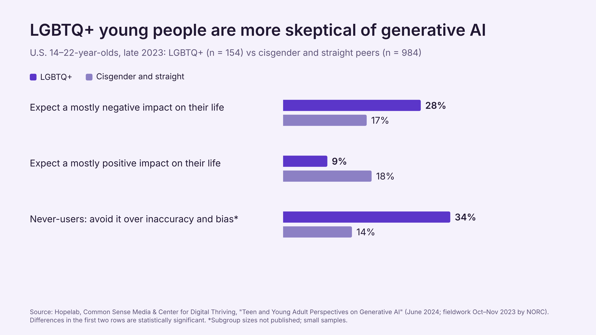

*Figure 14. LGBTQ+ youth outlook on generative AI. Source: Hopelab / Common Sense Media / Center for Digital Thriving (2024). *

- **Young people (Hopelab, Common Sense Media and the Center for Digital Thriving; survey late 2023; 154 LGBTQ+ vs 984 cisgender/straight 14–22-year-olds)** [21]. [Verified]
  - 28% of LGBTQ+ young people expected a mostly negative impact on their lives vs 17% of peers; 9% vs 18% expected mostly positive.
  - Among never-users, 34% vs 14% cited concerns about inaccuracy and bias.
  - Frequency of use didn't differ.
- **Adults (LGBT Tech, survey by Data for Progress, April 2025, n = 1,286)** [109]. [Verified; advocacy-organization survey with some text/chart inconsistencies]
  - 68–73% were somewhat or very concerned about algorithmic bias, moderation bias, misinformation, privacy risks that could expose LGBTQ+ identities, and replacing human oversight.
  - Transgender respondents reported 86–95% concern.
  - About 73% also saw promise (accurate identity, health and rights information; accessibility; community connection).
- **Emotional support (qualitative):** Hopelab's July 2026 study of 30 young people (oversampling LGBTQ+ youth) found they turn to AI for emotional support to avoid burdening others, avoid judgment, and get 24/7 availability [110]. [Verified]

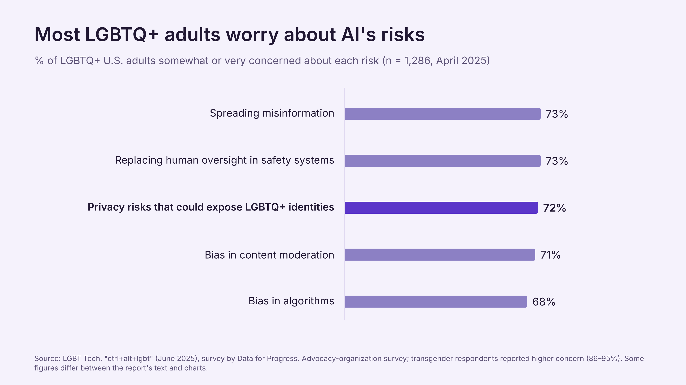

*Figure 15. LGBTQ+ adults' concerns about AI. Source: LGBT Tech / Data for Progress (2025). *

### 4.10 Queer people building AI

*Figure 16. Queer in AI 2021 community survey. Source: Queer in AI (2021 survey, reported in Rebuilding Trust). *

Queer in AI's 2021 survey of 142 members reported 85% lacked role models and 80% lacked community; 29% had been targeted by innuendo or jokes, 25% by derogatory comments, and 16% had feared for their physical safety [5]. Its larger 2021–22 survey (N = 252) reported 74% and 77% [55]. [Verified] The same survey contains self-harm items; present those only with a content warning.

Queer in AI now has more than 1,000 people in its Slack community and runs workshops at major AI conferences, including NeurIPS 2026 [54]. [Verified]

---

## 5. AI adoption and opinion: context for the hook

### 5.1 U.S. adults (Pew, 2026)

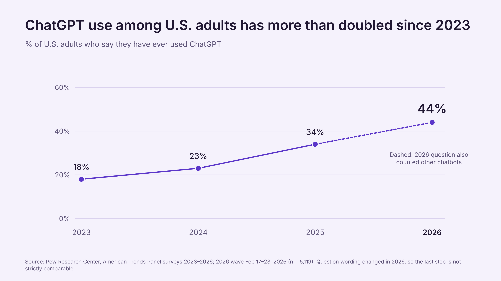

*Figure 17. ChatGPT use among U.S. adults, 2023–2026. Source: Pew Research Center (2026). *

Pew surveyed **5,119 U.S. adults on Feb 17–23, 2026** (margin of error ±1.6 points) and published "Americans and AI 2026" on June 17, 2026 [22, 111]. [Verified]

| Measure (% of all U.S. adults) | Value |
|---|---|
| Ever use an AI chatbot | 49% (2024: 33%, different question base) |
| Use daily (once, several times, or almost constantly) | 24% |
| Several times a day / almost constantly | 12% / 4% |
| Don't use chatbots | 51% |
| Read AI summaries at the top of search results | 60% |
| Used ChatGPT: 2023 → 2024 → 2025 → 2026 | 18% → 23% → 34% → 44% |

The ChatGPT series has a wording break: through 2025 the question asked "Have you ever used ChatGPT?" only of people who had heard of it; in 2026 it was part of a question about all chatbots asked of everyone [112]. Other 2026 chatbots (% of all adults): Gemini 24, Copilot 17, Meta AI 14, Grok 8, Claude 6, Character.ai 3 [22]. [Verified]

**Purposes (% of all adults; work is % of employed adults)** [22, 53] [Verified]: searching for information 42 (86% of users), tasks at work 38, fun 25, images or video 24, medical advice 20, diet and fitness 20, news 13, emotional support or advice 10 (20% of users), companionship 4 (8% of users). Pew's age breakdown puts emotional-support use at about 20% for 18–29-year-olds vs 2% for those 65+; confirm the table's base before quoting it [113]. Don't mix the all-adult and user bases, and don't add purposes together.

### 5.2 Using AI isn't the same as trusting it

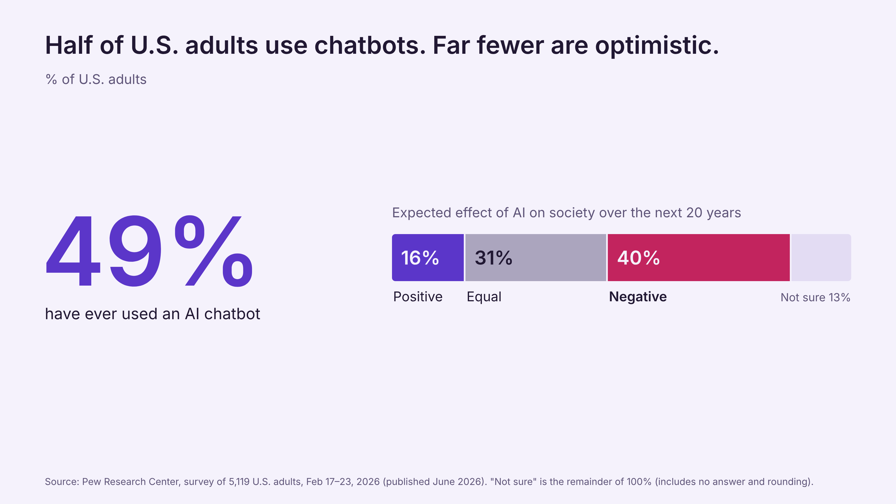

*Figure 18. Chatbot use versus optimism about AI. Source: Pew Research Center (2026). *

From the same survey [22] [Verified]:

| Opinion (% of U.S. adults) | Value |
|---|---|
| AI's impact on society over 20 years: negative / equal / positive / not sure | 40 / 31 / 16 / 13 |
| AI will make personal information less secure | 71 |
| Little or no confidence the government will regulate AI effectively | 67 |
| AI is advancing too quickly | 63 |
| Little or no confidence companies will develop and use AI responsibly | 59 |
| Chatbots help / hurt their productivity (all adults) | 30 / 5 (among users: 61 / 9) |

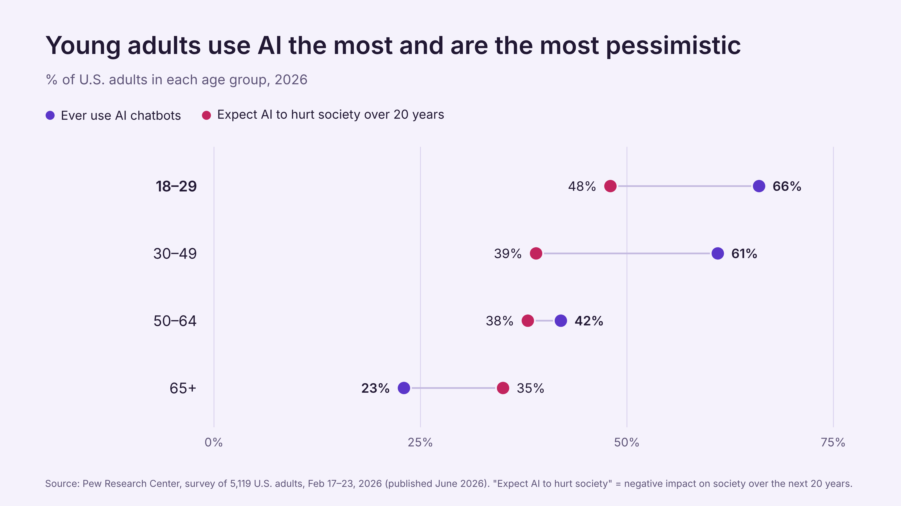

*Figure 19. AI use and pessimism by age. Source: Pew Research Center (2026). *

**By age** [113]: adults 18–29 use chatbots most (66%) *and* are the most likely to expect a negative impact on society (48%, vs 35–39% for older groups). [Verified] This is a strong hook for a student audience: high use and high skepticism coexist.

*Figure 20. Public concerns about AI. Source: Pew Research Center (2026). *

### 5.3 Why people abstain

*Figure 21. Why some U.S. adults don't use AI chatbots. Source: Pew Research Center (2026). *

Among adults who don't use chatbots [114, 115] [Verified]:

| Reason | Major | Major or minor |
|---|---|---|
| Not interested | 60% | 83% |
| Concerned about how their personal information will be used | 54% | 79% |
| Don't trust them to give accurate information | 45% | 76% |
| Don't know how to use them | 29% | 55% |
| Think others will judge them | 3% | 14% |

Source correction: the figures first appeared in the June 17 report and were republished in a Pew short read on **Oct 9, 2026**; cite those, not a newsletter. [Corrected] **Workshop line [Framing]:** "Not using AI is often an informed choice, not a skills gap."

### 5.4 Students

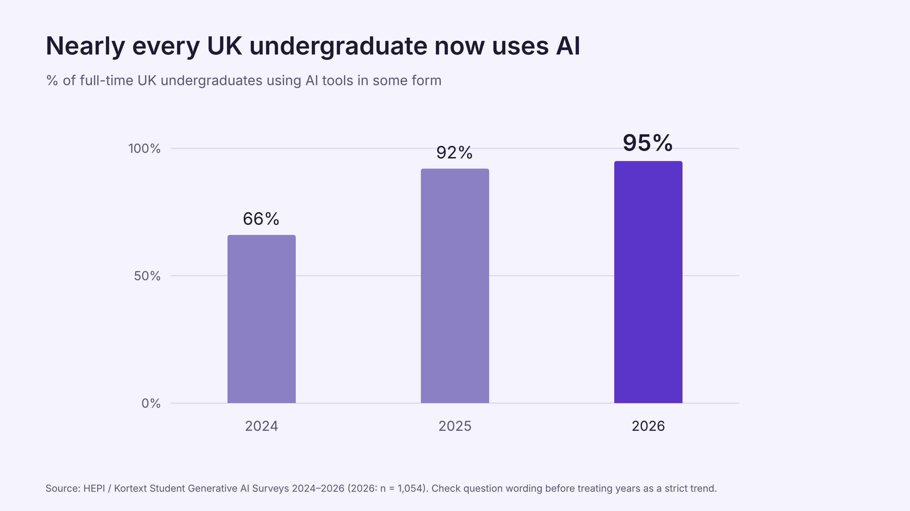

*Figure 22. UK undergraduate AI use, 2024–2026. Source: HEPI / Kortext (2024–2026). *

HEPI and Kortext surveyed **1,054 full-time UK undergraduates** in December 2025 (published March 12, 2026): **95%** use AI in some form and **94%** used generative AI to help with assessed work, up from 66% and 53% two years earlier [116, 117, 118]. [Verified]

- Caveats: 2024 used a different pollster; 2026 added answer options; HEPI says to compare "with caution." "Used AI for assessed work" doesn't mean cheating; 12% pasted AI text directly.
- 15% use AI for friendship, company or loneliness; 21% said it made them feel less lonely and 20% more lonely [116].
- Stanford's 2026 AI Index reports four in five U.S. high school and college students use AI for schoolwork, and 47% wanted to but weren't sure it was allowed [119]. [Verified via AI Index]

### 5.5 Developers

Stack Overflow's 2026 survey (30,903 respondents; sentiment question n = 14,428) found 62% favorable toward AI tools at work, 53% among developers with 1–5 years of experience vs 69% with 16+ years [26]. [Verified] The favorable series fell from 77% (2023) to 72% (2024) to 60% (2025) before 62% in 2026, but 2026 reworded the question and had a much smaller sample, so mark a break [120]. [Verified]

Most relevant for your verification theme, see Section 6.4: the largest single answer to "How much do you trust the output?" was "I trust it when I can easily verify the output" (48.0%) [26]. Stack Overflow's own claim of trust rising "from 31%" to 87% compares two different questions; don't repeat it. [Corrected]

---

## 6. AI productivity: measured vs perceived

Your notes frame AI as most useful as a "connector" and "aggregator" that finds human sources and recognizes patterns, with productivity scaling only insofar as output is objectively verified [6]. The verified evidence **supports that framing with two refinements**: verification is the key, and "checkable" is a better dividing line than "constrained vs creative." [Framing]

### 6.1 What a credible productivity claim needs

From the aggregate, still the right checklist [1]: name the **task**, **population**, **tool and year**, **outcome** (time, output, quality, learning), **design** (randomized, rollout, self-report), and **uncertainty**. Never average different studies into "AI improves productivity by X%." [Framing]

### 6.2 Measured studies

![Dot chart of effects for the AI group, with right meaning better. Speed: Noy and Zhang 40% less time; Dell'Acqua inside-frontier tasks 25% faster; METR early 2025 19% slower (95% CI 2–39% slower); METR late 2025 returning developers 18% faster but inconclusive. Output: Brynjolfsson +15% issues per hour; Cui +26% pull requests (CI +6 to +46%); Dell'Acqua +12% tasks. Quality: Noy and Zhang +18%; Dell'Acqua outside-frontier task 19% less likely correct; Cui build success −5.5% (not significant). Learning: Bastani −17% exam score after unguarded AI practice; Shen and Tamkin quiz 50% vs 67%.](../slides/public/graphics-lav/ai-11-measured-productivity-effects.png)

*Figure 23. Measured productivity effects of AI across studies. Source: Multiple peer-reviewed and working papers (see report). *

| Study | Population and design | Result | Status |
|---|---|---|---|
| Noy & Zhang, *Science* 2023 [23] | 453 college-educated professionals; randomized; short writing tasks | 40% less time; 18% higher grader-rated quality | [Verified] |
| Brynjolfsson, Li & Raymond, *QJE* 2025 [24] | 5,172 customer-support agents at one firm; staggered rollout (not an RCT) | +15% issues resolved per hour; about 30–36% for the least-skilled; about zero for the most experienced, with small quality declines | [Corrected: the 5,179 / 14% / 34% figures are from the 2023 working paper [40]] |
| Cui et al., *Management Science* [121] | 4,867 developers at Microsoft, Accenture and a Fortune 100 firm; three company RCTs | +26.08% completed pull requests (SE 10.3; roughly +6% to +46%) **for developers who used the tool**; build success rate −5.5% (not significant) | [Verified; now published] |
| Dell'Acqua et al., *Organization Science* 2026 [122] | 758 BCG consultants; preregistered field experiment with GPT-4 | Inside the "frontier": 12.2% more tasks, 25.1% faster, higher quality. On one task outside it: AI users were about 19% (or points) less likely to be correct | [Verified; quality "40%" figure from the 2023 version not re-checked] |
| METR, July 2025 [25] | 16 experienced open-source developers, 246 tasks in their own repos, early-2025 tools; randomized | **19% slower** with AI (95% CI 2–39% slower). Developers forecast 24% faster and believed afterward they'd been 20% faster | [Verified] |
| METR, Feb 2026 update [41] | 57 developers, 800+ tasks (from Aug 2025) | −18% time for returning developers (CI −38% to +9%), −4% for new ones (CI −15% to +9%); both include zero. 30–50% of developers withheld tasks they didn't want to do without AI, biasing results. METR: developers are "likely more sped up now," but data are "very weak evidence" of how much | [Verified] |
| Dillon et al., NBER 2025 [123] | 7,137 knowledge workers in 66 firms; randomized Microsoft 365 Copilot licenses; telemetry | About 1.4 fewer hours per week on email (−12%); no detectable change in meetings or documents | [Verified] |
| Humlum & Vestergaard, NBER (May 2025; rev. Mar 2026) [124] | 25,000 Danish workers, 7,000 workplaces, linked to admin data | Self-reported time savings about 3% (May 2025 version; not confirmed in the 2026 revision); no effect on earnings or recorded hours larger than 2% (Mar 2026 revision) | [Corrected: May 2025 version said 1%] |

**Workshop line [Framing]:** "AI made writers 40% faster on short tasks and helped newer support agents most, but in early 2025 it made expert developers slower on their own code, while they felt faster."

### 6.3 The perception gap

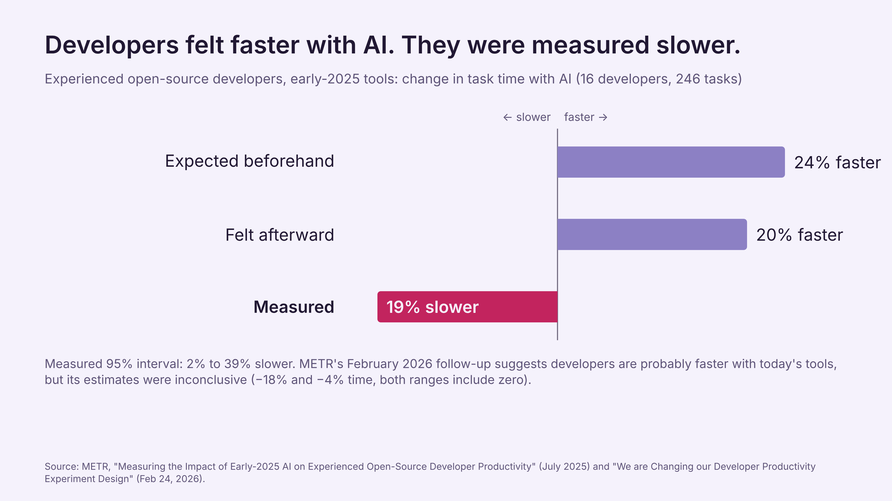

*Figure 24. Felt faster, measured slower (METR 2025). Source: METR (2025, 2026). *

The most durable finding isn't any single effect size; it's that **people's sense of AI speedup doesn't match measurement** [Verified]:

- METR 2025: forecast 24% faster, felt 20% faster, measured 19% slower [25].
- CFO survey (NBER, March 2026, about 750 firms): CFOs reported a 1.8% AI productivity gain for 2025, but the gain implied by their own revenue and staffing figures was 0.6% [125].
- The widely quoted St. Louis Fed figure (users saved 5.4% of work hours) is self-reported [126].

### 6.4 Verification: where your framing is strongest

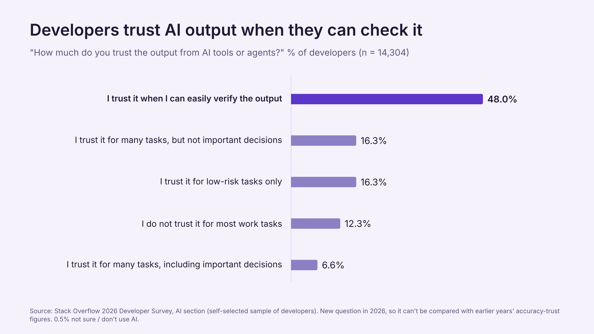

*Figure 25. How developers trust AI output. Source: Stack Overflow Developer Survey 2026. *

**Developers trust what they can check.** In Stack Overflow's 2026 survey (n = 14,304), the most common answer about trusting AI output was "I trust it when I can easily verify the output" (48.0%). Only 6.6% trust it for important decisions; 9.6% use responses as-is; 93% rate source citations as important for verification [26]. [Verified]

**Formal verification in math (Lean)** [Verified]:

- DeepMind's AlphaProof solved 4 of 6 IMO 2024 problems with proofs checked in the Lean proof assistant; humans translated the problems into Lean first [127].
- At IMO 2025, Gemini Deep Think reached gold-medal level in natural language, graded by IMO coordinators [128]; Harmonic's Aristotle produced Lean-verified proofs for 5 of 6 problems after humans formalized the statements [129].
- In 2026, Math, Inc.'s "Gauss" formalized the sphere-packing proofs in dimensions 8 and 24 (about 200,000 lines of Lean) and found a typo in the published paper [130].

**But verification checks correctness, not meaning or novelty** [Verified]:

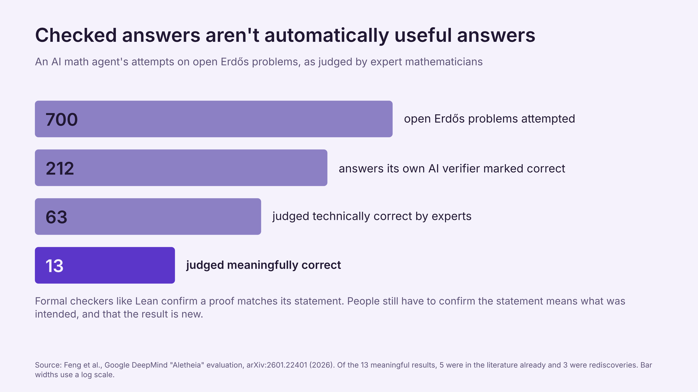

*Figure 26. Verified isn't the same as meaningful. Source: Feng et al. (2026), arXiv:2601.22401. *

- Erdős Problem #728 was solved "more or less autonomously" with AI and verified in Lean, but the problem as originally stated was misformulated, so humans had to choose the intended reading [27].
- Separately, a DeepMind agent attempted 700 open Erdős problems. Of 212 answers its own AI verifier (not Lean) marked correct, experts judged 63 technically correct and only **13 meaningfully correct**; of those, 5 were already in the literature and 3 were rediscoveries. The authors write that "formal verification cannot help with any of these difficulties" [28].

**Workshop line [Framing]:** "Verification scales trust in *correctness*. People still decide whether the question was the right one, and whether the answer is new."

### 6.5 The "connector to human sources" job, and where it fails

*Figure 27. Errors in AI assistants' news answers. Source: EBU & BBC (2025). *

Your notes say to let AI find human sources rather than interpret for you [6]. Evidence says that's wise, and also that **sourcing is exactly where assistants fail most**, so always click through [Verified]:

- An EBU and BBC study had journalists in 22 public-service media organizations (18 countries, 14 languages) evaluate 2,709 AI-assistant answers to news questions from late May to early June 2025.
- **45%** had at least one significant issue, **31%** had significant sourcing problems, and **20%** had significant accuracy problems.
- By assistant: Gemini 76%, Copilot 37%, ChatGPT 36%, Perplexity 30% had a significant issue [131].
- On the BBC subset, significant issues fell from 51% to 37% between rounds. It's a snapshot; models have changed.

Supporting evidence for the aggregator role: Brynjolfsson et al.'s tool spread top performers' knowledge to newer agents, with the biggest gains on moderately rare problems [24]. [Verified]

### 6.6 Constrained vs creative: a better dividing line

The evidence complicates "AI is better at rigid tasks than creative ones" [Verified]:

- Doshi & Hauser found AI ideas **raised** individual story ratings (+8.1% novelty for writers with the most AI access) but made stories **10.7% more similar** to each other, a loss of collective diversity [132].
- Dell'Acqua et al.'s "outside the frontier" task was analytical, with a hidden correct answer; AI produced plausible but wrong output and people trusted it [122].
- On the Remote Labor Index's 240 real freelance projects, the best AI agent completed about 2.5% to client standard [133].

**Better framing [Framing]:** "AI helps most where you can check the output, and hurts most where it sounds right and you can't tell."

### 6.7 Learning

[Verified]

- **Bastani et al. (PNAS 2025):** high-school math students with an unguarded GPT during practice scored 48% higher in practice but **17% lower** on the exam afterward; a tutor version with hints and no full answers improved practice by 127% and largely avoided the exam harm [134].
- **Shen & Tamkin (Anthropic, 2026):** 52 mostly junior engineers learning a new Python library with AI scored 50% vs 67% on a follow-up quiz, with no significant speed gain; interaction styles that kept learners engaged preserved learning [135].
- "Your Brain on ChatGPT" is an unreviewed preprint with 54 participants (18 in the final session); use only as an early signal [136].

**Workshop line [Framing]:** "If you're learning something, make the AI a tutor, not a ghostwriter."

---

## 7. Open models: what "open" means

### 7.1 Definitions

![Four columns. Closed (use only through the company's app or API; e.g. ChatGPT, Gemini, Claude): none of weights, open license, training code or data information. Open weights with custom license (e.g. Llama 4, Gemma 3, Muse Spark Open): weights only. Open weights with standard license (Apache-2.0 or MIT; e.g. Gemma 4, Qwen3, Mistral Small 4, DeepSeek, gpt-oss): weights and open license. Open source AI per OSI (e.g. OLMo, Pythia): weights, open license, training code and training-data information.](../slides/public/graphics-lav/om-03-how-open-is-open.png)

*Figure 28. Four levels of openness in AI models. Source: OSI OSAID 1.0; model cards. *

The Open Source Initiative's **Open Source AI Definition 1.0** (Oct 28, 2024) requires the freedoms to use, study, modify and share, plus the "preferred form for making modifications" [29] [Verified]:

- **Data information:** enough detail about training data for a skilled person to build a substantially equivalent system. It does *not* require releasing the data itself.
- **Code:** the complete code used to train and run the system.
- **Parameters:** the weights, under OSI-approved terms.

In OSI's validation exercise, Pythia, OLMo, Amber, CrystalCoder and T5 passed; Llama 2, Grok, Phi-2 and Mixtral did not. OSI calls these "not certifications of any kind" [137]. No version 1.1 was found as of Oct 2026. OSI describes open weights as a partial step [138]. [Verified]

**Four practical levels [Framing, built on OSI]:**

1. **Closed:** use only through the company's app or API.
2. **Open weights, custom license:** downloadable, with conditions (user caps, attribution, use policies).
3. **Open weights, standard license:** Apache-2.0 or MIT; use, modify, share.
4. **Open source AI (OSI):** weights plus training code plus training-data information.

*Figure 29. Three layers of an AI app. Source: Workshop framework; OSI OSAID 1.0. *

**One app, three sets of rules [Framing]:** an AI app has separate terms for (1) the interface you click, (2) the model weights, and (3) any connected services such as cloud models, web search, plugins and sync. An open-source app can call a proprietary cloud model; a proprietary app can run open weights locally.

### 7.2 License register (checked Oct 21, 2026)

*Figure 30. Open-weight model license register. Source: Model cards (Oct 2026). *

| Family (latest open release) | License | Strings attached | Data and code released? |
|---|---|---|---|
| Meta Llama 4 (Apr 5, 2025) [139, 140] | Llama 4 Community License | Companies over 700M monthly users must request a license; "Built with Llama" attribution; Acceptable Use Policy; multimodal models not licensed to people or companies based in the EU | No |
| Meta Muse Spark Open (Oct 15, 2026) [141] | Muse Model License | Companies with >$20M revenue offering it as an API must notify Meta and sign a separate agreement; "Built with Muse Spark Open" | Data no (sources described only); code not stated |
| Google Gemma 4 (Apr 2, 2026) [31] | **Apache-2.0** (new) | None beyond Apache. Gemma 3 and 3n stay under the Gemma Terms of Use [142] | No |
| Alibaba Qwen3 (Apr 2025) / Qwen3.8 (Aug 2026) [143, 144] | Qwen3 and Qwen3.8-27B: Apache-2.0; larger Qwen3.8 models: custom Community/Max licenses | Large models: revenue and user thresholds; model-as-a-service businesses need separate licenses | No |
| Mistral Small 4, Large 3, Ministral 3 [145] | Apache-2.0 | Medium 3.5 uses a "Modified MIT" license granting no rights to companies with >$20M monthly revenue | No |
| DeepSeek V4 / R1 [146, 147] | MIT (code and weights) | None; R1 explicitly allows distillation | No |
| OpenAI gpt-oss-120b / 20b (Aug 5, 2025) [148] | Apache-2.0 + two-sentence usage policy | Comply with applicable law | No |
| Ai2 Olmo 3 / 3.1 (Nov–Dec 2025) [30] | Apache-2.0 | None | **Yes**: training data (Dolma 3), code, checkpoints |

[Verified] Notes:

- The aggregate's "Llama: custom," "Gemma: custom," "Qwen: many Apache," "small Mistral: Apache," "DeepSeek-R1: MIT," "OLMo: Apache," "gpt-oss: Apache" are confirmed, with two updates: **Gemma 4 moved to Apache-2.0**, and **Meta's newest open-weight model is Muse Spark Open**, not a newer Llama. [Corrected]
- A "Llama 4.5" reported by one non-Meta site does not appear on Meta's pages. [Open]
- Pattern: several 2026 releases use "MIT-style plus conditions" licenses aimed at large resellers. Read the license file, not the name. [Framing]
- An Apache-2.0 weight license alone doesn't make a model "open source AI" under OSI's definition.

### 7.3 Adoption: enterprise share vs downloads

- **Enterprise:** Menlo Ventures surveyed **495** U.S. enterprise AI decision-makers (Nov 7–25, 2025). It estimated open-source models' share of enterprise LLM spending fell from 19% to 11%, and put enterprise API spend at Anthropic 40%, OpenAI 27%, Google 21% [149]. [Corrected: 495, not "nearly 500"; metric is dollar-weighted API usage] Menlo is an Anthropic investor; this isn't a census of AI use.
- **Downloads:** Hugging Face's Summer 2026 analysis (Jan–Jul 2026) found public model repositories grew from 2.43M to 2.96M; **1.5% of repos account for 99.2% of downloads**; 85.6% have fewer than 200 downloads; models under 1B parameters take 83% of downloads among models declaring size; 151,448 Qwen-based derivatives; repos tagged GGUF (a local-inference format) grew 464% [150]. [Verified] Downloads include automated pulls, not people.

**Workshop line [Framing]:** "Open models are losing share in enterprise APIs while exploding in local, small-model use. Different markets, different stories."

### 7.4 Capability: close, not equal

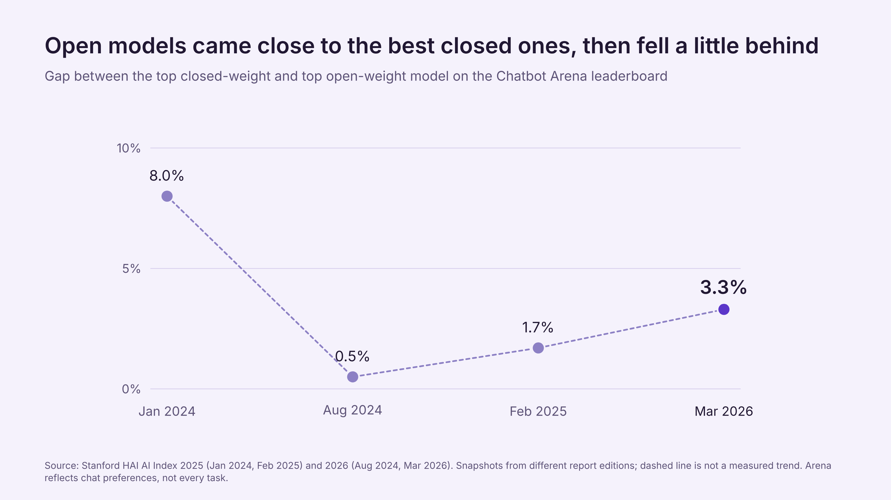

*Figure 31. Open vs closed model performance gap. Source: Stanford AI Index 2025, 2026. *

- Stanford's AI Index reported the gap between the top closed and top open model on Chatbot Arena narrowed from about 8.0% (Jan 2024) to 1.7% (Feb 2025) [151]. [Verified, rounded values]
- The 2026 Index reports the gap **re-opened**: 0.5% in August 2024, **3.3% by March 2026** [152]. [Corrected/updated]
- Arena reflects crowd preferences on chat prompts, not every task. The Foundation Model Transparency Index average fell from 58 (2024) to 40 (2025); open-model developers tend to score better [153]. [Verified]
- The 2026 Index notes Olmo 3.1 Think 32B matches Grok 4 on several benchmarks with about 90 times fewer parameters, and that hallucination rates across 26 top models range from 22% to 94% [119, 153]. [Verified]

### 7.5 Hardware: what fits on a student laptop

*Figure 32. Local model sizes vs laptop memory. Source: Ollama library (2026). *

Ollama's current docs no longer publish general RAM rules; the old "8 GB for 7B, 16 GB for 13B" guidance survives only on its Llama 2 page. LM Studio recommends 16 GB+ and supports only Apple Silicon Macs [154]. [Verified]

Default 4-bit download sizes from Ollama's library [155] [Verified]: Llama 3.2 3B 2.0 GB; Qwen3 4B 2.5 GB; Phi-4-mini 2.5 GB; Gemma 3 4B 3.4 GB; Llama 3.1 8B 4.9 GB; Qwen3 8B 5.2 GB; Qwen3 14B 9.3 GB; gpt-oss 20B 14 GB; Gemma 3 27B 17 GB.

**Practical rule [Framing]:** 8 GB handles 1–4B models comfortably and 7–8B tightly; 16 GB handles up to about 14B; you need headroom for the system and the conversation. The aggregate's arithmetic (an 8B model at 4 bits ≈ 4 GB of weights before overhead) matches. Test on a real laptop before promising anything on stage.

**Permissive small models for laptops and phones [Verified]:** Gemma 4 E2B/E4B (Apache-2.0, designed for phones and edge devices), Qwen3 0.6–8B (Apache-2.0), Phi-4-mini 3.8B (MIT), Ministral 3B/8B (Apache-2.0) [31, 143, 145].

---

## 8. Privacy and access control for AI

### 8.1 Seven questions

*Figure 33. Seven privacy questions for AI services. Source: Workshop framework. *

From your notes, kept as the audit framework [6] [Framing]:

| Question | What to examine |
|---|---|
| Training | Are prompts or outputs used to improve models? |
| Processing | Where does the model actually run? |
| Retention | What content, logs and metadata remain, and for how long? |
| Human access | Can reviewers, administrators or support staff see content? |
| Connected services | What do browsing, plugins, retrieval or sync transmit? |
| Deletion | What does deleting a chat remove, and what exceptions remain? |
| Authorization | Who can retrieve which documents or perform which actions? |

"Not used for training" answers only the first.

### 8.2 Consumer chatbots, October 2026

![Table for personal accounts. Gemini: trains by default unless Keep Activity is off; temporary chats kept up to 72 hours; human-reviewed chats kept up to 3 years; not used for ads. ChatGPT: trains by default unless 'Improve the model' is off; temporary chats up to 30 days; safety review; ads on Free and Go plans can use past chats with personalization on. Claude: user chooses; if on, data kept up to 5 years; incognito not used for training; flagged chats reviewed; no ads. Copilot new app: not used to train foundation models; retention not stated; personalized ads can use chat history. Meta AI: trains on interactions; retention not published; chats used for ads since Dec 16, 2025 excluding seven sensitive topics.](../slides/public/graphics-lav/pv-01-chatbot-privacy-matrix.png)

*Figure 34. Consumer AI chatbot privacy matrix. Source: Company policies (Oct 2026). *

All facts below apply to **personal accounts**; business, education and API products have separate terms. [Verified unless noted]

**Google Gemini apps** [156, 157, 158]

- "Keep Activity" is **on by default** for users 18+, and activity is used to train generative AI models.
- Activity auto-deletes after **18 months** by default (3 or 36 months, or never, are options).
- With Keep Activity off or in Temporary Chats, chats are kept up to **72 hours**. Google still uses them for safety, "including with help from human reviewers."
- Human-reviewed chats are kept up to **3 years**, disconnected from your account, and **aren't deleted when you delete your activity**.
- Since Sept 2, 2025, a sample of uploads is used to improve services unless you opt out.
- Google says Gemini chats are not used to show ads and that it would announce a change.

**OpenAI ChatGPT (Free, Plus, Pro, Go)** [159, 160, 44, 45, 161, 162, 163]

- Chats are used for training by default; turn off "Improve the model for everyone" in Data controls.
- Temporary Chats: not used for training; kept up to 30 days for safety. Deleted chats are removed within 30 days unless retention is required.
- **Ads began as a U.S. test on Feb 9, 2026 on the Free and Go plans**; as of Oct 21, 2026 they run in 89 countries. With ad personalization on, ad selection can use **past chats and memory**. Advertisers get only aggregate data. No ads for under-18s or in Temporary Chats; no ads near "personal health, mental health, or politics." [Corrected: the aggregate didn't include this] OpenAI's sensitive-topic list doesn't name sexual orientation or gender identity.
- Conversations suggesting planned harm to others go to a small review team and may be referred to law enforcement; OpenAI said in August 2025 it was not referring self-harm cases.
- The NYT litigation preservation order ended Sept 26, 2025, but OpenAI still holds some April–September 2025 data and a separate de-identified sample of 20 million consumer chats from Dec 2022 to Nov 2024 under legal hold. 2026 developments in that dispute weren't verified. [Partly open]

**Anthropic Claude (Free, Pro, Max)** [164, 46, 165, 166, 167]

- Users choose whether chats train models (required choice since Oct 8, 2025). If on, data may be kept **up to 5 years in de-identified form in training pipelines**; if off, **30 days**. [Verified]
- The privacy policy now frames training as something you opt out of. Press reported the original pop-up toggle was pre-set to on. [Secondary]
- Incognito chats aren't used for training (kept 30 days). Flagged content: inputs and outputs kept up to 2 years, safety classification scores up to 7 years; flagged or reported chats can be used even if you opt out.
- No ads (Feb 4, 2026 commitment, with a caveat that it could be revisited).

**Microsoft Copilot (personal account)** [42, 43, 168, 169] [Corrected]

- The **new Copilot app (Aug 18, 2026)** says prompts, responses and files "aren't used to train foundation models." The general Microsoft Privacy Statement still says Microsoft "may use your data to develop and train our AI models," so the wording is narrow.
- Ads: "Personalized ads might use your chat history, saved memories, and other Microsoft data"; generic ads use your current conversation. No personalized ads for under-18s.
- The new-app documents don't state retention. The aggregate's 18-month history and training opt-out describe the **older** app.

**Meta AI** [170, 171, 172, 173]

- Since **Dec 16, 2025**, Meta uses interactions with its AI features (text and voice) to personalize content and ads in most regions. It excludes seven sensitive topics from ads: religious views, **sexual orientation**, political views, health, racial or ethnic origin, philosophical beliefs, and trade union membership. **Gender identity is not on the list.** [Verified]
- "No opt-out" and the exclusion of the EU, UK and South Korea come from TechCrunch quoting Meta. [Secondary]
- In June 2025, users of the Meta AI app's Discover feed posted chats publicly apparently without realizing; chats weren't public by default, but the sharing flow was confusing. [Secondary]
- How long Meta keeps AI chats wasn't found. [Open]

**GitHub Copilot (Free, Pro, Pro+, Max)** [174, 175]

- From **April 24, 2026**, GitHub uses interaction data ("inputs, outputs, code snippets, and associated context") to train AI models unless you turn off "Allow GitHub to use my data for AI model training" under Copilot settings. Business and Enterprise are excluded. Private repository content "at rest" isn't used. [Verified]

### 8.3 School accounts are different

Check which account you're signed in with [Verified]:

- **Gemini with Google Workspace for Education:** chats and files "won't be reviewed by human reviewers or otherwise used to improve generative AI models" [176].
- **Microsoft Copilot Chat with a work or school account:** enterprise data protection applies; prompts aren't used to train foundation models, but **your institution's admins can see logs** through audit tools [177].
- ChatGPT Edu and Claude for Education are also excluded from consumer training [159, 164].

### 8.4 Local AI isn't automatically private

*Figure 35. Where your prompt goes: cloud vs local AI. Source: Workshop framework. *

- **Jan:** conversation history and logs stay on your computer; if you pick a remote API, data goes to that provider [178]. Analytics are opt-in [179]. [Verified]
- **Ollama:** "We don't see your prompts or data when you run locally," but its **cloud models and web search send data off-device and need sign-in**. Set `OLLAMA_NO_CLOUD=1` to stay local-only [180, 181]. [Verified]
- **LM Studio:** no telemetry, chats stay local, but it's proprietary and has paid cloud tiers [182, 34]. [Verified]
- **AnythingLLM:** anonymous telemetry is **on unless you disable it**, contradicting its "nothing phones home" marketing [183]. [Verified]

**Replace the aggregate's retired claim [Framing]:** "A correctly configured local workflow can avoid transmitting prompt content to a model provider. Local histories, logs, backups, sync, connected tools, and device access still need to be evaluated."

### 8.5 Private-document assistants (from the aggregate, still valid)

A model's license governs the model, not who may read your documents [29]. If you build anything that answers questions over private files [Framing]:

- authenticate users before retrieval;
- enforce document permissions **before** content enters the prompt;
- avoid shared indexes that leak restricted material across users;
- restrict tool permissions and confirm consequential actions;
- audit logs, backups, exports and integrations;
- test cross-user leakage explicitly;
- treat retrieved text as untrusted input, not instructions.

---

## 9. Practical alternatives register (checked Oct 21, 2026)

Every entry was checked against the project's official site, LICENSE file and release page. Prices and versions change; re-check anything you put on a slide the morning of the talk. Install difficulty: **1** = installer or app store, no terminal; **2** = some setup; **3** = needs a terminal or server.

*Figure 36. Start-here everyday open source swaps. Source: Project sites (Oct 2026). *

### 9.1 Local AI

| Tool | Replaces | License | Platforms | Latest release | Install | Cost | Privacy posture | Honest tradeoff |
|---|---|---|---|---|---|---|---|---|
| **Jan — start here** [179, 184] | ChatGPT desktop | Apache-2.0 (was AGPL until May 20, 2025) | Windows, macOS, Linux | v0.8.7, Oct 20, 2026 | 1 | Free | Data stays local; analytics opt-in; optional cloud models send prompts to that provider | Local models don't run on Intel Macs; increasingly agent-heavy |
| **PocketPal AI — start here on phones** [185] | ChatGPT mobile | MIT | iOS, Android | v1.20.1 (Oct 2026) | 1 | Free (in-app purchases) | On-device; App Store says "Data Not Collected," but Google Play's label lists possible collection | Small models are much weaker; heat and battery |
| Ollama [186, 180] | ChatGPT (via a model runner) | MIT | macOS and Windows app; Linux via terminal | v0.40.x, Oct 2026 | 1 (Mac/Win), 2 (Linux) | Free locally; cloud plans $20–$500/month | Local prompts not collected; cloud models and web search need sign-in; `OLLAMA_NO_CLOUD=1` disables them | Now promotes paid cloud models; show how to turn cloud off |
| AnythingLLM [183] | ChatGPT with files / NotebookLM | MIT | Windows, macOS (incl. Intel), Linux | v1.18.0, Oct 2026 | 1 | Free | Local by default; telemetry on until disabled | Busier interface; good fallback for Intel Macs |

**Flag or drop** [Verified]:

- **GPT4All** (MIT): last release v3.10.0 on Feb 25, 2025, about 20 months ago. Not a first pick [32].
- **Open WebUI:** not OSI open source since v0.6.6 (Apr 19, 2025); BSD-3 plus a branding clause above 50 users, and a contributor license agreement. Needs Docker or Python (difficulty 3) [33].
- **LM Studio:** proprietary; its terms call the source code a trade secret. Apple Silicon only on Mac. Free locally; paid cloud tiers [34].
- **Msty:** proprietary; free tier is personal, non-commercial use only [187].

### 9.2 Secure communication

| Tool | Replaces | License | Platforms | Latest | Install | Cost | Privacy posture | Honest tradeoff |
|---|---|---|---|---|---|---|---|---|
| **Signal — start here** [188] | WhatsApp, iMessage, Messenger | AGPL-3.0 | iOS, Android; desktop linked to a phone | Android 8.32.x, Oct 2026 | 1 | Free (non-profit); optional $1.99 secure backups | End-to-end encrypted by default; usernames (since Feb 2024) let you avoid sharing your number; set "Who can find me by number" to Nobody | **Still requires a phone number to register**, which matters for people who aren't out |
| **SimpleX Chat — if a phone number is a problem** [189] | WhatsApp, Telegram | AGPL-3.0 | iOS, Android, desktop | 7.0.x, Sept 2026 | 1 | Free | No phone number, email or user ID; E2EE by default; audited by Trail of Bits | Your friends probably aren't on it; contact-by-link takes explaining |
| Element / Element X (Matrix) [47] | Slack, Discord, group chats | AGPL-3.0 apps (moved under a Sept 2024 post); SDKs Apache-2.0 | iOS, Android, web, desktop | Element X iOS 26.10.x, Oct 2026 | 1–2 | Free on matrix.org | DMs and private rooms E2EE by default (not re-verified); data lives on the homeserver you choose | Confusing for beginners (homeservers) |
| Thunderbird [190] | Outlook, Apple Mail | MPL-2.0 (desktop); Apache-2.0 (Android) | Windows, macOS, Linux, Android; **iOS not released** | 158.0, Oct 13, 2026 | 1 | Free | Works with any provider; telemetry on by default (opt-out) | Doesn't make your email provider private |
| Delta Chat [191] | WhatsApp, over email | GPL-3.0 app / MPL-2.0 core | All major platforms | 2.62 | 1 | Free | No phone number; E2EE by default | No forward secrecy yet |

Proton Mail's apps are open source (GPL-3.0) but its servers are not [192]. [Verified]

### 9.3 Browsers (brief)

- **Firefox — start here** (MPL-2.0; every platform; 158.0, Oct 13, 2026). Telemetry is on by default; the settings toggle turns off most of it, but a separate daily-active-users ping remains [193].
- **Mullvad Browser** (MPL-2.0; desktop only): strong anti-fingerprinting; always private mode [194].
- **LibreWolf** (desktop only): Firefox with telemetry removed; license file couldn't be fetched [195]. [Open]

### 9.4 Studio art and media

*Figure 37. Start-here creative open source swaps. Source: Project sites (Oct 2026). *

| Tool | Replaces | License | Platforms | Latest | Install | Cost | Privacy | Honest tradeoff |
|---|---|---|---|---|---|---|---|---|
| **Krita — start here** [196] | Procreate, Photoshop (painting) | GPL-3.0 | Windows, macOS, Linux; Android tablets and Chromebooks (beta); **no iPad** | 5.3.4, Sept 15, 2026 | 1 | Free (paid store versions support development) | No account; local files | Not a photo editor or an iPad app |
| GIMP [197] | Photoshop (photos) | GPL-3.0-or-later | Windows, macOS, Linux | 3.2.6, Sept 10, 2026 | 1 | Free | No account | Different workflow; **GIMP has no official App Store version**, so App Store listings are third-party |
| Inkscape [198] | Illustrator | GPL-2.0-or-later source; GPL-3.0-or-later binaries | Windows, macOS, Linux | 1.4.4, May 2026 | 1 | Free | No account | Slower on very complex files; limited CMYK |
| **Kdenlive — start here for video** [199] | Premiere, CapCut | GPL-3.0 | Windows, macOS, Linux | 26.08.2, Oct 13, 2026 | 1 | Free | No account | Fewer pro color and audio tools |
| Blender [200] | Maya, Cinema 4D | GPL-3.0-or-later binaries | Windows, Linux, **Apple Silicon Macs only** | 5.2.2 LTS, Sept 2026 (5.3 due Nov 10) | 1 | Free | No account | Steep learning curve |
| OBS Studio [201] | Streamlabs, screen recorders | GPL-2.0-or-later | Windows, macOS, Linux | 32.2.2 (33.0 in release candidate) | 1 | Free | No account; local recordings | More manual setup |
| Audacity [202] | Audition | GPL-3.0 | Windows, macOS, Linux | 4.0.1, Sept 30, 2026 (new interface) | 1 | Free | No account; update checks on by default, usage tracking opt-in; the 2021 telemetry proposal was never merged | Older tutorials won't match v4 |
| Penpot [203] | Figma | MPL-2.0 | Web browser | 2.18.x, Oct 2026 | 1 (cloud), 3 (self-host) | Free tier; paid plans | Cloud account required | Fewer plugins than Figma |

### 9.5 Notes, documents, passwords and organization

| Tool | Replaces | License | Platforms | Latest | Install | Cost | Privacy | Honest tradeoff |
|---|---|---|---|---|---|---|---|---|
| **Bitwarden — start here for passwords** [204] | LastPass, 1Password, browser passwords | GPL-3.0 clients; AGPL-3.0 server (some `bitwarden_license` folders proprietary) | All platforms, browser extensions | 2026.10.0 | 1 | Free; Premium $19.80/year | End-to-end encrypted vault; account required; US or EU region | You trust its cloud unless you self-host |
| KeePassXC [205] | Same, offline | GPL-2.0-only or GPL-3.0-only | Desktop only (compatible third-party mobile apps) | 2.7.12, Mar 2026 | 1 desktop / 2 overall | Free | No account, no cloud | You handle sync and backups |
| **LibreOffice — start here for documents** [206] | Microsoft Office | MPL-2.0 | Windows, macOS, Linux | 26.8.1, Oct 2, 2026 | 1 | Free | No account | Complex .docx/.pptx can shift; export to PDF before submitting |
| **Joplin — start here for notes** [207] | Notion, OneNote, Evernote | AGPL-3.0-or-later (since Dec 2022); Joplin Server uses a non-open personal-use license | All platforms | 3.7.x, Sept 2026 | 1 (sync setup ~2) | Free; optional Joplin Cloud from €2.99/month (50% student discount) | Local files; end-to-end encryption opt-in | Plainer editor; limited real-time collaboration |

**Drop from the open-source list** [Verified]:

- **Obsidian:** closed source, though free for any use since Feb 20, 2025 [208]. Fine as a "free but not open" contrast.
- **Anytype:** "Any Source Available License," not open source; no in-app analytics opt-out [209].
- **Logseq:** split into two products on Apr 24, 2026; the new database version is beta and warns of possible data loss [210].

*Figure 38. Free isn't open source. Source: Project license pages (Oct 2026). *

### 9.6 Start-here summary

| Category | Start here | Why |
|---|---|---|
| Local AI (laptop) | Jan | Apache-2.0, one-click installers, analytics off by default, updated this week |
| Local AI (phone) | PocketPal AI | App-store install, runs on-device |
| Messaging | Signal (SimpleX if a phone number is a problem) | E2EE by default; usernames hide your number |
| Browser | Firefox | Every platform; one toggle turns off most telemetry |
| Passwords | Bitwarden | Free, every platform, biggest security win |
| Documents | LibreOffice | Free, mature; export PDF for Word-only instructors |
| Notes | Joplin | Open format, syncs via services you already use |
| Painting | Krita | Normal installer; Android tablets and Chromebooks |
| Video | Kdenlive | Covers typical student editing |
| Code hosting (open projects) | Codeberg | Non-profit, no AI training on your code (Section 10.6) |

---

## 10. Navigating GitHub and vetting open source

### 10.1 Seven checks before installing

*Figure 39. Seven checks before installing open source software. Source: Workshop checklist; OpenSSF; CHAOSS. *

Adapted from the OpenSSF "Concise Guide for Evaluating Open Source Software" (revised April 2025) and CHAOSS project-health metrics [211, 212] [Framing]:

| Check | What to inspect |
|---|---|
| Identity | Does the official website link to this exact repository? (Not a typo-squatted fork) |
| License | Is there a LICENSE file with an open source license? Check subfolders and SDKs too |
| Maintenance | Recent releases or commits, and real replies to issues |
| Distribution | Install from the official site or app store, not a re-upload |
| Security | A SECURITY policy, published advisories, signed releases |
| People | More than one or two active maintainers |
| Fit | Your platforms, accessibility needs, and a way to export your data |

The aggregate's correction stands: "no release in six months" is a prompt to investigate, not a fail. A mature tool can be stable. [Framing]

### 10.2 Popularity signals can be faked or flooded

*Figure 40. Popularity signals can be faked or flooded. Source: He et al. (ICSE 2026); Stenberg (2026). *

- **Fake stars:** "Six Million (Suspected) Fake Stars on GitHub" (ICSE 2026) flagged about 6 million suspected fake stars across 26,254 repositories before cleanup, and 18,617 repositories (301K accounts) after. At the July 2024 peak, **16.66% of popular repositories** had fake-star campaigns. Overall, the authors found the majority of fake stars promoted short-lived phishing and malware repositories [36]. [Corrected: the 18,617 figure is post-cleanup, the 6M pre-cleanup]
- **Report floods:** curl ended its bug bounty on **Jan 31, 2026**. Over its life it paid more than $100,000 for 87 confirmed vulnerabilities, but the share of valid reports fell from over 15% to under 5% from 2025 as AI-generated reports flooded in [213, 214]. The "conflicting payout totals" were snapshots from different dates ($84,260 in Oct 2024; over $90K in Jul 2025; over $100K in Jan 2026). After moving reports back to HackerOne without payment (Mar 1, 2026), curl paused all security-report intake from July 1 to Aug 3, 2026 [215, 216]. [Verified]

### 10.3 A few people carry a lot

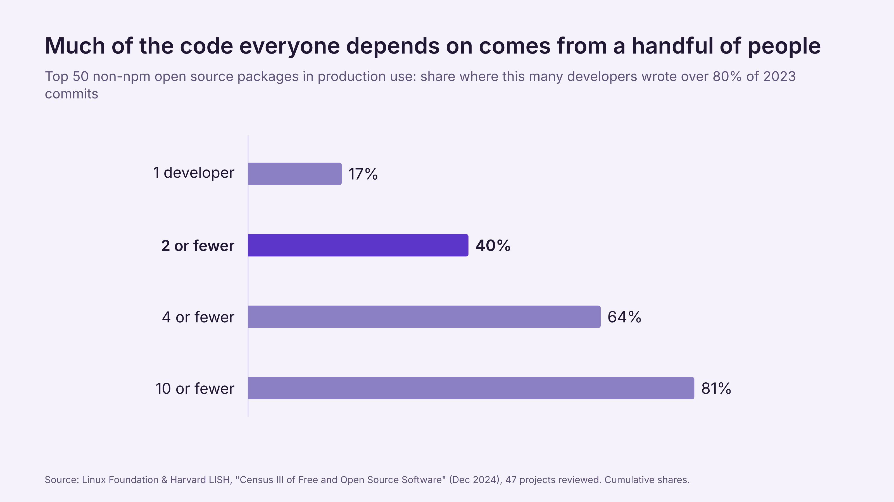

*Figure 41. Maintainer concentration in widely used packages. Source: Census III (2024). *

- **Census III** (Linux Foundation and Harvard, Dec 2024) found that among the top 50 non-npm packages in production use, 17% had one developer writing over 80% of 2023 commits, 40% had two or fewer, and 64% four or fewer [217]. [Verified]
- **Tidelift's 2024 maintainer survey** (400+ maintainers): 60% unpaid; 60% have quit or considered quitting; maintainers spend 11% of their time on security, up from 4% in 2021 [218]. [Secondary report of the survey]
- **xz-utils (March 2024):** a backdoor was slipped into the xz release tarballs 5.6.0 and 5.6.1, created and signed by "Jia Tan," a contributor who had gained trust over several years (activity from about 2021, per secondary accounts). In 2022 the original maintainer wrote that his ability to care had been limited by "longterm mental health issues," amid pressure from suspected sock-puppet accounts. Andres Freund caught it after noticing unusual CPU use and Valgrind errors in SSH on a test system [219, 220, 221]. [Verified; timeline secondary] Use it to make "People" a real check, with care: the maintainer is a person, not a cautionary tale.

### 10.4 A license is a snapshot, not a promise

*Figure 42. Open source license changes, 2021–2025. Source: Project announcements. *

| Project | Change | Date | Community response |
|---|---|---|---|
| Elasticsearch | Apache-2.0 → SSPL / Elastic License | Jan 2021 | OpenSearch fork |
| Terraform | MPL-2.0 → Business Source License | Aug 10, 2023 | OpenTofu fork (Linux Foundation, Sept 20, 2023) |
| Redis | BSD-3 → RSALv2 / SSPL | Mar 20, 2024 | Valkey fork (Linux Foundation, Mar 28, 2024) |
| Elasticsearch | Adds AGPL-3.0 option | Aug 29, 2024 | Back to an OSI license |
| Bitwarden | Desktop client pulled in a proprietary SDK | Oct 2024 | Flagged by users, fixed in about a week; since Oct 2025 the core SDK is dual GPL-3.0 / proprietary |
| Open WebUI | BSD-3 → custom license with branding clause | Apr 19, 2025 | No longer OSI open source |
| Redis 8 | Adds AGPL-3.0 option | May 1, 2025 | Back to an OSI license |
| Jan | AGPL-3.0 → Apache-2.0 | May 20, 2025 | More permissive |

Sources: [222, 223, 224, 225, 226, 227, 204, 33, 228, 184]. [Verified; OpenSearch fork from background knowledge]

### 10.5 AI crawlers are a real cost for volunteer infrastructure

[Verified unless noted]

- **Read the Docs:** one crawler downloaded 73 TB in May 2024; blocking AI crawlers cut download bandwidth by 75% [229].
- **Wikimedia:** multimedia download bandwidth grew 50% since January 2024, and at least 65% of its most resource-consuming traffic comes from bots [230].
- **SourceHut:** its founder reported spending 20–100% of some weeks fighting aggressive LLM crawlers [231].
- **Codeberg:** crawlers moved to residential proxies; expensive routes now sit behind Anubis, a challenge page browsers solve automatically [232].
- GNOME, KDE and Fedora incidents are reported by LibreNews [233]. [Secondary]

### 10.6 GitHub's AI-training terms and the alternatives

![Table of code-hosting sites. GitHub: terms grant GitHub and Microsoft the right to train AI on your content; the opt-out doesn't cover public repos; Copilot interactions are used for training unless you opt out since April 24, 2026; Microsoft subsidiary. Codeberg: pledges never to train on users' code, blocks AI crawlers; German non-profit. SourceHut: terms forbid collecting data to train ML models; small paid company. GitLab.com: public-content training not addressed; Duo inputs and outputs not used to train; open-core public company.](../slides/public/graphics-lav/oss-05-where-your-code-trains-ai.png)

*Figure 43. Code hosts and AI training. Source: GitHub ToS (2026); Codeberg (2026); SourceHut; GitLab. *

Your notes ask for transparency about GitHub's policies and to show Codeberg and other options [6]. Here is what the documents say, quoted where it matters. **Not legal advice.** [Verified]

**GitHub Terms of Service, effective April 27, 2026** [16] (quoted wording checked against the live page on Oct 21, 2026):

- **§D.4 License Grant to Us:** "You grant GitHub and our Affiliates the right to store, host, archive, parse, display, and make copies of Your Content … as necessary to provide, develop, and improve the Service, including by training AI Features, and for the purpose of training, developing, and improving artificial intelligence and machine learning models and technologies of our Affiliates." It adds that such use "is within the scope of this license and does not constitute a sale."
- **§J.3:** GitHub may train on your AI-feature inputs and outputs "unless (a) you opt out through your account settings, or (b)" you're under an enterprise agreement. But: "The opt-out right … does not apply to the license granted in Sections D.4-D.8 or to any Content that does not constitute Input or Output **(including Content stored in public repositories)**."
- **§E.3 (private repositories):** GitHub won't otherwise use private repository contents to develop the service, except content you send to an AI feature.
- **Copilot interaction data (since Apr 24, 2026):** used for training on Free, Pro, Pro+ and Max plans unless you disable "Allow GitHub to use my data for AI model training" [175, 174].

**Workshop line [Framing]:** "As of April 2026, GitHub's terms let GitHub and Microsoft train AI on what you put there. You can opt out for your Copilot chats, not for your public repos."

**Alternatives** [Verified]:

| Host | Stance on AI training | Who runs it | Practical notes |
|---|---|---|---|
| **Codeberg** | "The Codeberg forge and its associated services are not and will not use the code or data of projects and users to train" LLMs [35]; robots.txt blocks major AI crawlers [234] | Codeberg e.V., a German non-profit with member votes | Free; runs Forgejo (GPL-3.0-or-later) [235]. **Only for free/open projects**; private repos limited (about 100 MB, for FOSS contributors) [236]. **Since July 2026, members voted (358–144) to stop welcoming "vibe-coded" projects created autonomously by LLM agents or "written and maintained with heavy use of LLMs"**, enforced case by case [35] |
| **SourceHut** | Terms forbid automated collection to train ML models; from Sept 10, 2026, new projects may not contain "original content written with or which facilitates the use of LLMs" [237, 238] | Small company; public alpha | Paid (€4–12/month to host); email-based workflow; steep learning curve |
| **GitLab.com** | "No inputs to or outputs from GitLab Duo features are currently used to train any GitLab models"; public-content training not addressed [239] | Public company (open core) | Free tier limits [240]; Community Edition is MIT [241] |
| **Forgejo (self-hosted)** | You control robots.txt and crawler blocking | Community project | Server administration required |

**A note for your own discovery tool [Framing]:** if it was built with substantial AI assistance, Codeberg's new policy and SourceHut's LLM-code ban may affect where you can host it. Read both before choosing, and consider disclosing how AI was used either way.

---

## 11. Designing the discovery tool

Your notes describe a tool that scores open-weight models and open-source projects on transparent criteria, periodically finds well-maintained software by category, and gives "regular people rhetorical power" to judge software [6]. This section maps those ideas to existing standards so you can reuse them and say so on stage.

### 11.1 Prior art to build on

[Verified]

- **OpenSSF Scorecard:** 19 automated checks, each scored 0–10 and combined with published risk weights (Critical 10, High 7.5, Medium 5, Low 2.5); scans more than 1.3 million repositories weekly, with an API. Checks include Maintained, License, Contributors, Code-Review, Security-Policy, Signed-Releases, Vulnerabilities, Branch-Protection, Pinned-Dependencies and Dangerous-Workflow [242].
- **OpenSSF Concise Guide:** a human checklist covering need, authenticity, maintenance (activity in the last 12 months, multiple maintainers), security practices, license, adoption, sandbox testing and code review. It has no AI section [211].
- **CHAOSS:** 89 community-health metrics. Its "Starter Project Health" model uses Time to First Response, Change Request Closure Ratio, Contributor Absence Factor (the smallest group making 50% of contributions; formerly "bus factor"), and Release Frequency [212].
- **Data sources:** deps.dev (Google; dependency graphs and advisories for seven ecosystems) [243] and ecosyste.ms (open APIs over about 16 million packages; CC BY-SA data) [244].

**Positioning [Framing]:** Scorecard covers security hygiene, CHAOSS covers community health, deps.dev and ecosyste.ms supply data. A student-facing tool that adds **license clarity, governance, forge choice, and AI-privacy signals**, explained in plain language, complements rather than duplicates them.

### 11.2 Your criteria, mapped

*Figure 44. Discovery tool criteria mapped to standards. Source: OpenSSF; CHAOSS; presenter's notes. *

| Your criterion | Established measure to reuse | Caution |
|---|---|---|
| Total commits, active developers | CHAOSS Contributor Absence Factor; Scorecard "Contributors" | Commit counts reward churn; count people, not commits |
| License (or previous license) | Scorecard "License"; SPDX identifier; license history in git | Check subfolders and SDKs (Bitwarden, Section 10.4) |
| Association with an organization | Foundation membership; governance files | Backing can change (Terraform, Redis) |
| Releases, merged issues over time | Scorecard "Maintained"; CHAOSS Release Frequency, Change Request Closure Ratio, Time to First Response | A quiet, mature tool isn't abandoned |
| Documentation freshness | Docs-site last-modified dates | Easy to fake with trivial edits |
| AI commits / AI-resolved issues | No standard yet; would need a published method | Disclosure varies; don't infer from writing style |
| Hidden or proprietary components | Dependency license scan (deps.dev, ecosyste.ms) | Cloud features may live outside the repo |
| AI privacy (the seven questions) | Score each from the app's own policy page, with the date checked | Policies change often (Copilot changed in Aug 2026) |
| Popularity | Use cautiously, if at all | Fake stars (Section 10.2); downloads count robots |

### 11.3 Design principles from the evidence [Framing]

1. **Publish every weight and its justification**, as your notes require. Scorecard publishes its weights; do the same.
2. **Show the evidence behind each score** with a link and the date checked, so users can disagree with you.
3. **Prefer people to commits** (CHAOSS) and **license files to README claims.**
4. **Treat stars and downloads as weak or zero weight** (fake stars; robot downloads).
5. **Separate "maintained" from "active."** A stable tool with security fixes and no new features can be healthy.
6. **Version your scoring method** and say when it changed.
7. **Add the disclaimer you planned:** scores are a starting point for judgment, not a verdict.
8. **Protect your own users' data the way Queer in AI does:** collect the minimum, aggregate before publishing [5].

---

## 12. Gaps the aggregate listed, now filled

These are mostly Q&A material.

### 12.1 AI energy

The IEA estimates data centres used about **415 TWh (about 1.5% of world electricity) in 2024** and **485 TWh in 2025**, projected to reach roughly **950 TWh (about 3%) by 2030**. AI-focused data centres grew about 50% in 2025. The IEA publishes no single "AI share" of data-centre electricity; data centres include all workloads [245, 246]. [Verified] Stanford's AI Index estimates a short GPT-4o query at about 0.42 Wh, about 40% more than a Google search [119]. [Verified]

### 12.2 AI labor

TIME reported in 2023 that Kenyan contractors labeling traumatic content to make ChatGPT safer took home about $1.32–$2 per hour, while OpenAI paid the contractor $12.50 per hour, which the contractor said covered all costs [247]. Kenyan content moderators' lawsuits against Meta and its contractor can proceed in Kenya and remain unresolved as of 2026 [248] [Secondary/academic]. Fairwork's 2025 ratings scored Remotasks (Scale AI) 2/10 and Amazon Mechanical Turk 0/10 on fair-work standards [249]. [Verified]

### 12.3 AI companions

Common Sense Media's 2025 survey of 1,060 U.S. teens (NORC) found 72% had used AI companions and 52% used them regularly; among users, 33% had chosen an AI over a person for something serious [250]. [Verified] An OpenAI and MIT Media Lab study found emotional engagement is rare overall but concentrated among heavy users, and personal conversations were associated with higher loneliness (correlational, not peer-reviewed) [251]. A JAMA Pediatrics study found 19.2% of 12–21-year-olds had used chatbots for mental-health advice; it had no LGBTQ+ breakdown [252]. Regulatory facts: the FTC opened a study of seven companion-chatbot companies on Sept 11, 2025 [253], and California's SB 243 on companion chatbots was signed Oct 13, 2025 [254]. [Verified] LGBTQ-specific quantitative data remains thin; Hopelab's qualitative work is the best current source (Section 4.9).

### 12.4 Age verification and app-store removals

Covered in Sections 2.8 and 2.9.

### 12.5 Meta AI

Covered in Section 8.2. Chat retention remains unpublished. [Open]

---

## 13. Presentation-ready claims

Each is short enough for a slide and backed by a verified primary source.

| Claim | Source |
|---|---|
| Half of U.S. adults use AI chatbots; far fewer are optimistic (49% use; 16% expect a positive impact on society) | Pew 2026 [22] |
| Young adults use AI most and are the most pessimistic (66% use; 48% expect a negative impact) | Pew 2026 [113] |
| Among non-users, 79% are concerned about how their personal information would be used | Pew 2026 [114] |
| Norway treated simply using Grindr as data revealing sexual orientation; an appeals board and two courts upheld the NOK 65M fine | Datatilsynet; Forbrukerrådet [9, 57] |
| In Oct 2026 Norway also fined ad-tech firm Xandr NOK 92M over the same data flows (appealable) | noyb; BleepingComputer [10, 58] |
| Three FTC orders (2024–2025) protected location data tied to LGBTQ+ places; law-firm analyses say the 2026 Kochava order's list doesn't name them | FTC; Proskauer [11, 12, 13, 14, 15] |
| ZIP code, gender and birth date single out most Americans (87% in 1990 data; 63% in a re-check) | Sweeney; Golle [71, 72] |
| Being the default is worth billions: Google paid $26.3B in 2021; users "rarely" switch | U.S. v. Google [17] |
| 95% of gender-recognition papers treated gender as binary | Keyes 2018 [18] |
| In English Wikipedia, "he" appears 15M+ times; the string "xe" about 4,500 times, mostly not even as a pronoun | Dev et al. 2021 [100] |
| A moderation AI rated many drag queens as more "toxic" than white nationalist leaders | InternetLab; Dias Oliva et al. [19, 51] |
| LGBTQ+ young people were more likely to expect AI to hurt their lives (28% vs 17%) | Hopelab 2024 [21] |
| Developers felt 20% faster with AI and were measured 19% slower (early 2025) | METR [25] |
| Developers' top answer on trusting AI: "when I can easily verify the output" (48%) | Stack Overflow 2026 [26] |
| 45% of AI assistants' news answers had a significant issue; sourcing was the biggest problem | EBU/BBC 2025 [131] |
| Of 212 AI answers its own verifier marked correct, experts found 13 meaningful | Feng et al. 2026 [28] |
| "Open" AI has levels; few model families release weights, code and data information | OSI; Ai2 [29, 30] |
| GitHub's terms let GitHub and Microsoft train AI on your content; the opt-out doesn't cover public repos | GitHub ToS 2026 [16] |
| About 6M suspected fake GitHub stars; 1 in 6 popular repos had campaigns at the July 2024 peak | He et al., ICSE 2026 [36] |
| 40% of the most-used non-npm packages had one or two people writing over 80% of the code | Census III [217] |
| oSTEM and Queer in AI pay grad-application fees (up to $750); deadline Nov 3, 2026 | Queer in AI [54] |

### Claims to retire or qualify

| Earlier wording | Use instead |
|---|---|
| "Local AI has no retention policy" / "nothing local can be subpoenaed" | "A correctly configured local workflow can avoid sending prompts to a model provider; check local history, logs, backups, sync and plugins." |
| "AI improves productivity by X%" | Name task, population, outcome, year and study |
| "Students are medium users" / "the public is nontechnical" | Describe the sampled population |
| "Public repositories are open source" | "Check the LICENSE file" |
| "Downloads measure users" | "Downloads count requests, many automated" |
| "More releases means safer" / "No release in six months means abandoned" | "Investigate maintenance and security practices" |
| "Apache weights mean the whole AI system is open source" | "Check OSI's code and data-information requirements" |
| "The company owns everything you upload" | "Most terms grant a license to use, which can be broad" |
| "An index score is your probability of being harmed" | "GLAAD's index scores published policies" |
| "Sonatype: 67% growth from 6.6T to 9.8T" | "About 9.8 trillion downloads in 2025" (no growth figure, or attribute 67% to the press release) |
| "60% of GitHub's fastest-growing projects are AI" | "6 of the 10 fastest-growing repos were AI infrastructure" |
| "AI makes developers 19% slower" (present tense) | "In early 2025, experienced developers were measured 19% slower while feeling 20% faster" |
| "LGBTQ people are almost 3x as likely to be depressed or anxious" | CDC 2023: 41% vs 13% of high schoolers seriously considered suicide; adult depression/anxiety about 1.5–2.6x |
| "EU AI Act Article 10(5) lets developers use sensitive data to fix bias" | "Now Article 4a (July 2026), wider and optional" |
| "Rekognition matched Black Caucus members with criminals" | "…with mugshots" |
| "Copilot lets you opt out of training; keeps chats 18 months" | Applies to the older app; new app: not used for foundation-model training; ads can use chat history |
| "GPT4All / Open WebUI / LM Studio are open-source picks" | GPT4All stale; Open WebUI custom license; LM Studio proprietary |
| "Element went AGPL in 2023" | Servers in 2023; apps in 2024 |

---

## 14. Verification register: what changed from the aggregate

Status key: **C** confirmed · **X** corrected · **U** updated (newer information) · **S** secondary only · **O** still open.

| # | Aggregate item (status there) | Now | Detail |
|---|---|---|---|
| 1 | Sonatype 9.8T downloads (Checked) | C | 2025 data, four registries [37] |
| 2 | Sonatype "+67%" (Checked) | X | Press release only; not reproducible; don't pair with 6.6T [38] |
| 3 | Sonatype supply 2022 3.3M/47M, 2023 3.9M/60M (Inherited) | C/X | Confirmed; 2024 totals row is a copy of 2023 (row sums ~6.8M/84.6M); 2025 uses a new method (~8.0M/113M) [255, 256, 257] |
| 4 | Malware growth (not in aggregate) | U | 454,600+ new malicious packages in 2025; 1.233M cumulative; "75%" is cumulative growth [258] |
| 5 | Octoverse 180M devs / 230 repos/min / 986M commits (Checked) | C | Period Sep 2024–Aug 2025 [39] |
| 6 | "~60% of fastest-growing projects AI" (Checked) | X | 6 of 10 fastest-growing repos were AI infrastructure |
| 7 | Pew adoption, purposes, opinions, nonuse (Checked) | C | Nonuse source is the June report / Oct 9 short read, not an Oct 15 newsletter [114, 115] |
| 8 | Stack Overflow sentiment and usefulness (Checked) | C | 2026 wording break; trust question new [26] |
| 9 | HEPI 95% / 94%; series 66→92→95 (Checked/secondary) | C | Comparability caveats; 2025 assessed-work restated as 89% [116] |
| 10 | Noy & Zhang 453 / 40% / 18% (Inherited) | C | [23] |
| 11 | Brynjolfsson 5,172 / ~15% (Inherited) | C/X | QJE: 5,172 / 15%; 5,179 / 14% / 34% are the 2023 WP [24] |
| 12 | Cui 4,867 / 26.08% (Inherited) | C | Effect for users who used the tool (IV); published in *Management Science* [121] |
| 13 | METR 16 devs / 246 tasks / 19% (Inherited) | C | CI +2% to +39% [25] |
| 14 | METR follow-up (Open question) | U | Feb 24, 2026 update; inconclusive speedups; selection problems [41] |
| 15 | OSI OSAID (Checked) | C | No v1.1 found [29] |
| 16 | Model licenses (Inherited) | C/U | Gemma 4 → Apache-2.0; Muse Spark Open; Qwen3.8 mixed; Mistral Medium 3.5 "Modified MIT"; DeepSeek V4 MIT; Olmo 3 [Section 7.2] |
| 17 | Menlo 19%→11%; 40/27/21 (Checked) | C/X | 495 respondents; dollar-weighted API share [149] |
| 18 | Hugging Face 2.43M→2.96M etc. (Inherited) | C | Published Aug 14, 2026; Jan–Jul 2026; GGUF +464% counts repos [150] |
| 19 | AI Index 8%→1.7% (Checked) | C/U | Rounded values confirmed; gap re-opened to 3.3% by Mar 2026 [152] |
| 20 | FMTI 58→40 (Checked) | C | 2024 vs 2025 editions [153] |
| 21 | Gemini retention (Checked) | C/U | Plus: human review continues with activity off; reviewed chats survive deletion; uploads used since Sept 2025; no ads [156] |
| 22 | Copilot opt-out, 18 months (Checked) | X | Older app only; new app (Aug 18, 2026) differs [42] |
| 23 | Claude 5 years vs 30 days (Inherited) | C | De-identified, training pipelines; flagged content 2/7 years [46] |
| 24 | ChatGPT defaults, NYT hold (Inherited) | C/U | Training default on; ads launched 2026; preservation order ended Sept 26, 2025; 20M-chat hold [44, 161] |
| 25 | Meta AI (Open question) | U/S | Ads from Dec 16, 2025; seven excluded topics; retention not found [170] |
| 26 | Grindr NOK 65M; appeal upheld Oct 21, 2025 (Inherited) | C | Finality unconfirmed [9] |
| 27 | Xandr NOK 92M Oct 2026 (Inherited) | C | Decision Oct 2, announced Oct 12, 2026; appealable [10] |
| 28 | FTC Gravy/Venntel, Mobilewalla, Kochava (Inherited) | C/U/S | Kochava settled (announced May 4, 2026); "no LGBTQ+ category" and Jun 25 entry date are secondary [14, 15] |
| 29 | Flo litigation; $59.5M; Meta verdict (Inherited) | O | FTC 2021 order confirmed; 2026 class-action status not verified |
| 30 | Gender-affirming-care subpoenas (Inherited) | O | Not verified from primary sources this session |
| 31 | HRW 20 / 45 / 40 / 17 (Inherited) | C | 120 interviews, five countries [66] |
| 32 | GLAAD SMSI 2025/2026 scores (Inherited) | C | Released May 13, 2025 and May 7, 2026 [68] |
| 33 | Google default payments; dark patterns (Inherited leads) | C | $26.3B; $20B to Apple; Amazon $2.5B; Epic $245M [17, 86, 87] |
| 34 | Firefox "ownership" example (Inherited) | C/O | Revised license text confirmed; original Feb 2025 wording not confirmed [91] |
| 35 | Shortlist tools (Inherited) | C/X | See Section 9 flags: GPT4All stale; Open WebUI; Element dates; Thunderbird Android Apache-2.0; LibreOffice 26.8 |
| 36 | Hardware "8 GB runs X" (Inherited background) | X | Replaced with Ollama download sizes and LM Studio requirements [155, 154] |
| 37 | Fake stars ~6M / 18,617 repos (Inherited) | X | 6M pre-cleanup (26,254 repos); 18,617 post-cleanup; ICSE 2026 [36] |
| 38 | Relicensing register (Inherited) | C | Dates confirmed; Bitwarden 2025 follow-up added [Section 10.4] |
| 39 | curl bounty end Jan 31, 2026; conflicting totals (Inherited) | C | Totals are dated snapshots [213] |
| 40 | Queer AI ethics leads: Keyes, orientation inference, toxicity (Inherited) | C | Section 4 |
| 41 | AI energy, labor, companions, age verification, app stores, AI crawlers (Open questions) | U | Sections 2.8–2.9, 10.5, 12 |
| 42 | GitHub AI training policies (Notes) | U | ToS §D.4/§J.3 (Apr 27, 2026); Copilot data (Apr 24, 2026) [16] |
| 43 | Bragazzi "almost 3x" (paper) | X | Section 4.7 |
| 44 | Fosch-Villaronga drag-queen citation; EU Art. 10(5) (paper) | X | Section 4.5, 4.6 |
| 45 | Queer in AI paper claims (paper) | C/X | Mugshots, not criminals; survey figures confirmed; NIST filing unconfirmed |

---

## 15. Still open

The shared web-search budget for this session ran out before these could be closed. Each needs one targeted search or a docket check. [Open]

1. **Flo Health class action:** 2026 status of the Meta verdict damages, judgments and appeals; final settlement amounts.
2. **DOJ subpoenas to gender-affirming-care providers:** court rulings after Sept 2025 and current status.
3. **Grindr Norway finality:** whether a Supreme Court appeal was sought.
4. **Meta AI chat retention** and Meta's own statement of the "no opt-out" policy.
5. **NYT v. OpenAI:** rulings on the 20-million-chat sample after Nov 2025.
6. **Firefox's original Feb 2025 license wording** and exact post dates.
7. **Copilot new app:** retention period and human review.
8. **Virginia and Connecticut 2026 location-data laws:** bill numbers and effective dates.
9. **Johnson & Goldstein (2003) default-effect figures** (42% vs 82%), if you want a non-tech defaults example.
10. **Queering the Map's current submission count** (500,000+ as of June 2023).
11. **Grindr's 2022 removal from China's App Store** from a primary report.
12. **GNOME, KDE and Fedora crawler figures** from the original posts.

None of these is needed for the core talk; each has a verified fallback noted in its section.

---

## 16. Graphics index

In this repository, every graphic is in [`slides/public/graphics-lav/`](../slides/public/graphics-lav/) under the file name listed below (without the `-dark`/`-light` suffix). The groupings follow the talk segments. Alt text, sources and data tables are in [`graphics.md`](graphics.md) and [`data/`](../data/).

**Hook and AI context**

- `ai-01-chatgpt-adoption` — ChatGPT use among U.S. adults, 2023–2026 (Figure 17)
- `ai-05-use-vs-outlook` — Chatbot use versus optimism about AI (Figure 18)
- `ai-09-use-and-pessimism-by-age` — AI use and pessimism by age (Figure 19)
- `ai-08-student-ai-use` — UK undergraduate AI use, 2024–2026 (Figure 22)
- `ai-04-public-concerns` — Public concerns about AI (Figure 20)
- `ai-03-why-people-abstain` — Why some U.S. adults don't use AI chatbots (Figure 21)

**Why digital autonomy matters**

- `risk-02-grindr-data-timeline` — Grindr data case timeline (Figure 1)
- `risk-03-ftc-location-orders` — FTC location-data orders and LGBTQ+ places (Figure 2)
- `risk-04-hrw-digital-targeting` — Human Rights Watch digital targeting cases (Figure 3)
- `risk-01-glaad-safety-scores` — GLAAD Social Media Safety Index 2025–2026 (Figure 4)
- `qa-09-three-facts-identify-you` — Re-identification from three facts (Figure 5)
- `dg-04-why-popular-isnt-best-fit` — Six forces behind software popularity (Figure 7)
- `rh-01-defaults-are-paid-for` — Defaults are paid for (Figure 8)

**Queer AI ethics**

- `qa-06-misgendering-machines` — How gender-recognition research modeled gender (Figure 9)
- `qa-08-gender-shades` — Gender Shades error rates (Figure 10)
- `qa-07-moderation-drag-queens` — Moderation AI and drag queens' tweets (Figure 12)
- `qa-05-wikipedia-pronouns` — Pronoun mentions in English Wikipedia (Figure 11)
- `qa-01-queer-in-ai-survey` — Queer in AI 2021 community survey (Figure 16)
- `qa-02-queer-chatbot-evidence-funnel` — Scoping review funnel: chatbots for LGBTQ+ people (Figure 13)
- `qa-03-lgbtq-youth-ai-outlook` — LGBTQ+ youth outlook on generative AI (Figure 14)
- `qa-04-lgbtq-adults-ai-concerns` — LGBTQ+ adults' concerns about AI (Figure 15)

**Software audit**

- `dg-01-audit-matrix` — Software audit matrix (Figure 6)
- `dg-03-seven-privacy-questions` — Seven privacy questions for AI services (Figure 33)

**Alternatives and local AI**

- `sw-01-start-here-everyday` — Start-here everyday open source swaps (Figure 36)
- `sw-02-start-here-creative` — Start-here creative open source swaps (Figure 37)
- `sw-03-free-isnt-open-source` — Free isn't open source (Figure 38)
- `dg-02-ai-three-layers` — Three layers of an AI app (Figure 29)
- `dg-05-local-vs-cloud` — Where your prompt goes: cloud vs local AI (Figure 35)
- `om-03-how-open-is-open` — Four levels of openness in AI models (Figure 28)
- `om-05-model-license-register` — Open-weight model license register (Figure 30)
- `om-04-what-fits-on-a-laptop` — Local model sizes vs laptop memory (Figure 32)
- `om-01-open-vs-closed-gap` — Open vs closed model performance gap (Figure 31)
- `pv-01-chatbot-privacy-matrix` — Consumer AI chatbot privacy matrix (Figure 34)
- `ai-10-developer-trust` — How developers trust AI output (Figure 25)
- `ai-11-measured-productivity-effects` — Measured productivity effects of AI across studies (Figure 23)
- `ai-12-felt-faster-measured-slower` — Felt faster, measured slower (METR 2025) (Figure 24)
- `ai-13-ai-news-answers-errors` — Errors in AI assistants' news answers (Figure 27)
- `ai-14-verified-isnt-meaningful` — Verified isn't the same as meaningful (Figure 26)

**Vetting OSS and GitHub**

- `oss-06-vet-before-you-install` — Seven checks before installing open source software (Figure 39)
- `oss-03-popularity-signals-can-lie` — Popularity signals can be faked or flooded (Figure 40)
- `oss-02-few-maintainers` — Maintainer concentration in widely used packages (Figure 41)
- `oss-04-licenses-change` — Open source license changes, 2021–2025 (Figure 42)
- `oss-05-where-your-code-trains-ai` — Code hosts and AI training (Figure 43)

**Discovery tool**

- `oss-07-discovery-tool-criteria` — Discovery tool criteria mapped to standards (Figure 44)

---

## References

All URLs accessed October 21, 2026 unless noted.

1. "Digital Autonomy, Open Software, and AI: Research aggregate for the oSTEM workshop" (Aggregate Research PDF, Oct 21, 2026).
2. E. Fosch-Villaronga & G. Malgieri, "Queering the ethics of AI," ch. 21 in D. J. Gunkel (ed.), *Handbook on the Ethics of Artificial Intelligence* (Edward Elgar, 2024), p. 301ff. Preprint: https://arxiv.org/abs/2308.13591
3. N. L. Bragazzi et al., "The Impact of Generative Conversational Artificial Intelligence on the Lesbian, Gay, Bisexual, Transgender, and Queer Community: Scoping Review," *J Med Internet Res* 25:e52091 (2023). https://www.jmir.org/2023/1/e52091
4. D. Jędrusiak, "Queering AI as a Speculative Practice: An Analysis of the Artistic Explorations of New Paradigms for Developing Inclusive AI," *HT '24*, pp. 17–22 (ACM, 2024). https://doi.org/10.1145/3648188.3675157
5. Organizers of Queer in AI (Ashwin, W. Agnew, U. Pajaro, H. Jethwani, A. Subramonian), "Rebuilding Trust: Queer in AI Approach to Artificial Intelligence Risk Management" (2021). https://arxiv.org/abs/2110.09271
6. Presenter's notes, "Notes.md" (oSTEM workshop project file).
7. Presenter's project brief, "System Prompt.md" (oSTEM workshop project file).
8. oSTEM, "oSTEM Annual Conference Presenter Packet 2026" (Speaker Kit PDF).
9. Datatilsynet, "The Court of Appeal upholds the fine against Grindr" (2025). https://www.datatilsynet.no/en/news/news-2025/the-court-of-appeal-upholds-the-fine-against-grindr/
10. noyb, "Privacy win: Norwegian authority fines Microsoft's Xandr €8.5 million" (Oct 12, 2026). https://noyb.eu/en/privacy-win-norwegian-authority-fines-microsofts-xandr-eu-85-million
11. FTC, "FTC Order Prohibits Data Broker X-Mode Social and Outlogic from Selling Sensitive Location Data" (Jan 9, 2024; final Apr 12, 2024). https://www.ftc.gov/news-events/news/press-releases/2024/01/ftc-order-prohibits-data-broker-x-mode-social-outlogic-selling-sensitive-location-data
12. FTC, "FTC Finalizes Order Prohibiting Gravy Analytics, Venntel from Selling Sensitive Location Data" (Jan 14, 2025). https://www.ftc.gov/news-events/news/press-releases/2025/01/ftc-finalizes-order-prohibiting-gravy-analytics-venntel-selling-sensitive-location-data
13. FTC, "FTC Finalizes Order Banning Mobilewalla from Selling Sensitive Location Data" (Jan 14, 2025). https://www.ftc.gov/news-events/news/press-releases/2025/01/ftc-finalizes-order-banning-mobilewalla-selling-sensitive-location-data
14. FTC, Kochava and Collective Data Solutions stipulated order announcement (May 4, 2026). https://www.ftc.gov/news-events/news/press-releases/2026/05/ftc-ban-kochava-subsidiary-selling-sensitive-location-data-settle-charges-they-sold-location-data
15. Proskauer, "FTC Remains on the Location Data Beat…" (2026) [secondary]. https://www.proskauer.com/blog/ftc-remains-on-the-location-data-beat-agency-settles-long-running-kochava-enforcement-even-as-state-regulation-has-already-changed-the-landscape
16. GitHub Terms of Service (effective Apr 27, 2026), §§ D.4, E.3, J.3. https://docs.github.com/en/site-policy/github-terms/github-terms-of-service
17. U.S. and Plaintiff States, D.C. Circuit cross-appeal brief in *United States v. Google LLC* (Jul 28, 2026), quoting the Aug 5, 2024 liability opinion. https://www.justice.gov/atr/media/1454586/dl?inline
18. O. Keyes, "The Misgendering Machines: Trans/HCI Implications of Automatic Gender Recognition," *Proc. ACM Hum.-Comput. Interact.* 2(CSCW), Art. 88 (2018). https://doi.org/10.1145/3274357
19. InternetLab, "Drag queens and Artificial Intelligence: should computers decide what is 'toxic' on the internet?" (Jun 28, 2019). https://internetlab.org.br/en/news/drag-queens-and-artificial-intelligence-should-computers-decide-what-is-toxic-on-the-internet/
20. J. Dodge et al., "Documenting Large Webtext Corpora: A Case Study on the Colossal Clean Crawled Corpus," *EMNLP 2021*, pp. 1286–1305. https://aclanthology.org/2021.emnlp-main.98/
21. Hopelab, Common Sense Media & Center for Digital Thriving, "Teen and Young Adult Perspectives on Generative AI" (Jun 2024). https://digitalthriving.gse.harvard.edu/wp-content/uploads/2024/06/Teen-and-Young-Adult-Perspectives-on-Generative-AI.pdf
22. Pew Research Center (J. Gottfried et al.), "Americans and AI 2026: Chatbots, Smart Devices and Views on Impact" (Jun 17, 2026). https://www.pewresearch.org/internet/2026/06/17/americans-and-ai-2026-chatbots-smart-devices-and-views-on-impact/
23. S. Noy & W. Zhang, "Experimental evidence on the productivity effects of generative artificial intelligence," *Science* 381(6654) (2023). https://doi.org/10.1126/science.adh2586
24. E. Brynjolfsson, D. Li & L. Raymond, "Generative AI at Work," *Quarterly Journal of Economics* 140(2):889–942 (2025). https://academic.oup.com/qje/article/140/2/889/7990658
25. METR (J. Becker et al.), "Measuring the Impact of Early-2025 AI on Experienced Open-Source Developer Productivity" (Jul 2025). https://arxiv.org/abs/2507.09089
26. Stack Overflow, 2026 Developer Survey: AI (data licensed ODbL 1.0). https://survey.stackoverflow.co/2026/ai
27. Erdős Problems database, Problem #728. https://www.erdosproblems.com/728
28. T. Feng et al. (Google DeepMind), evaluation of the "Aletheia" agent on open Erdős problems (2026). https://arxiv.org/abs/2601.22401
29. Open Source Initiative, "The Open Source AI Definition – 1.0" (Oct 28, 2024). https://opensource.org/ai/open-source-ai-definition
30. Ai2, "Olmo 3" (Nov 20, 2025). https://allenai.org/blog/olmo3
31. Google, "Gemma 4" announcement (Apr 2, 2026). https://blog.google/innovation-and-ai/technology/developers-tools/gemma-4/
32. Nomic, GPT4All releases (v3.10.0, Feb 25, 2025). https://github.com/nomic-ai/gpt4all/releases
33. Open WebUI, License documentation. https://docs.openwebui.com/license
34. LM Studio, App Terms (Aug 23, 2026). https://lmstudio.ai/app-terms
35. Codeberg, "Protecting our FLOSS commons from LLMs" (Jul 23, 2026). https://blog.codeberg.org/protecting-our-floss-commons-from-llms.html
36. H. He et al., "Six Million (Suspected) Fake Stars on GitHub: A Growing Spiral of Popularity Contests, Spams, and Malware," *ICSE 2026*. https://arxiv.org/abs/2412.13459
37. Sonatype, *2026 State of the Software Supply Chain*, "When OSS Growth Meets Gravity" (Jan 28, 2026). https://www.sonatype.com/state-of-the-software-supply-chain/2026/software-infrastructure-growth
38. Sonatype press release, "Sonatype Research Reveals OSS Malware Grows 75% as Yearly Open Source Downloads Surpass 9.8 Trillion" (Jan 28, 2026). https://www.sonatype.com/press-releases/sonatype-research-reveals-open-malware-grows-75-percent
39. GitHub, "Octoverse: A new developer joins GitHub every second as AI leads TypeScript to #1" (Oct 28, 2025). https://github.blog/news-insights/octoverse/octoverse-a-new-developer-joins-github-every-second-as-ai-leads-typescript-to-1/
40. E. Brynjolfsson, D. Li & L. Raymond, "Generative AI at Work," NBER Working Paper 31161 (2023). https://www.nber.org/papers/w31161
41. METR, "We are Changing our Developer Productivity Experiment Design" (Feb 24, 2026). https://metr.org/blog/2026-02-24-uplift-update/
42. Microsoft, "Microsoft Copilot: activity history" (new app, Aug 18, 2026). https://support.microsoft.com/en-us/privacy/microsoft-copilot/activity-history
43. Microsoft, "Microsoft Copilot: privacy controls" (new app). https://support.microsoft.com/en-us/privacy/microsoft-copilot/privacy-controls
44. OpenAI Help Center, "Ads in ChatGPT." https://help.openai.com/en/articles/20001047-ads-in-chatgpt
45. OpenAI, "ChatGPT ads expand to 26 new countries" (Oct 21, 2026). https://openai.com/index/chatgpt-ads-expands-26-new-countries/
46. Anthropic Privacy Center, "How long do you store my data?" (updated Jul 1, 2026). https://privacy.claude.com/en/articles/10023548-how-long-do-you-store-my-data
47. Element, "Sustainable licensing at Element with AGPL" (Sep 5, 2024). https://element.io/blog/sustainable-licensing-at-element-with-agpl
48. Regulation (EU) 2026/1744 amending Regulation (EU) 2024/1689 ("Digital Omnibus on AI"), OJ L, Jul 24, 2026. https://eur-lex.europa.eu/legal-content/EN/TXT/HTML/?uri=OJ:L_202601744
49. CDC, Verlenden et al., "Mental Health and Suicide Risk Among High School Students and Protective Factors — YRBS, United States, 2023," *MMWR Suppl* 73(4):79–86 (Oct 10, 2024). https://www.cdc.gov/mmwr/volumes/73/su/su7304a9.htm
50. M. King et al., "A systematic review of mental disorder, suicide, and deliberate self harm in lesbian, gay and bisexual people," *BMC Psychiatry* 8:70 (2008). https://doi.org/10.1186/1471-244X-8-70
51. T. Dias Oliva, D. M. Antonialli & A. Gomes, "Fighting Hate Speech, Silencing Drag Queens? Artificial Intelligence in Content Moderation and Risks to LGBTQ Voices Online," *Sexuality & Culture* 25(2):700–732 (2021). https://doi.org/10.1007/s12119-020-09790-w
52. Google.org, "The Trevor Project's Crisis Contact Simulator" (2021). https://blog.google/outreach-initiatives/google-org/trevor-project-crisis-contact-simulator/
53. Pew Research Center, "Americans and AI" topline (Jun 17, 2026). https://www.pewresearch.org/wp-content/uploads/sites/20/2026/06/PI_2026.06.17_Americans-and-AI_TOPLINE.pdf
54. Queer in AI & oSTEM, "Graduate School Application Program" (2026/27 round). https://www.queerinai.com/grad-app-aid
55. Queer in AI et al., "Queer In AI: A Case Study in Community-Led Participatory AI," *FAccT '23* (2023). https://arxiv.org/abs/2303.16972
56. Forbrukerrådet, "Complaints against Grindr and five third-party companies" (Jan 14, 2020). https://www.forbrukerradet.no/side/complaints-against-grindr-and-five-third-party-companies/
57. Forbrukerrådet (Norwegian Consumer Council), "Grindr loses appeal" (Oct 21, 2025). https://www.forbrukerradet.no/news-in-english/grindr-loses-appeal/
58. BleepingComputer, "Norway fines Microsoft ad firm $9.6 million over Grindr data sharing" (Oct 12, 2026) [secondary; cites Datatilsynet]. https://www.bleepingcomputer.com/news/security/norway-fines-microsoft-ad-firm-96-million-over-grindr-data-sharing/
59. A. Ghorayshi & S. Ray, "Grindr Is Letting Other Companies See User HIV Status And Location Data," BuzzFeed News (Apr 2, 2018). https://www.buzzfeednews.com/article/azeenghorayshi/grindr-hiv-status-privacy
60. Grindr Inc., Form 8-K (filed Sep 4, 2026). https://www.sec.gov/Archives/edgar/data/0001820144/000182014426000027/grnd-20260902.htm
61. J. Keegan & J. Eastwood, "From 'Heavy Purchasers' of Pregnancy Tests to the Depression-Prone: We Found 650,000 Ways Advertisers Label You," The Markup (Jun 8, 2023). https://themarkup.org/privacy/2023/06/08/from-heavy-purchasers-of-pregnancy-tests-to-the-depression-prone-we-found-650000-ways-advertisers-label-you
62. FTC, "FTC Finalizes Order with InMarket Prohibiting It from Selling or Sharing Precise Location Data" (May 1, 2024). https://www.ftc.gov/news-events/news/press-releases/2024/05/ftc-finalizes-order-inmarket-prohibiting-it-selling-or-sharing-precise-location-data
63. The Pillar, "Pillar Investigates: USCCB gen sec Burrill resigns after sexual misconduct allegations" (Jul 20, 2021). https://www.pillarcatholic.com/p/pillar-investigates-usccb-gen-sec
64. Washington State, My Health My Data Act, RCW 19.373. https://app.leg.wa.gov/RCW/default.aspx?cite=19.373.010
65. FTC, "FTC Finalizes Order with Flo Health, a Fertility-Tracking App that Shared Sensitive Health Data with Facebook, Google, and Others" (Jun 22, 2021). https://www.ftc.gov/news-events/news/press-releases/2021/06/ftc-finalizes-order-flo-health-fertility-tracking-app-shared-sensitive-health-data-facebook-google
66. Human Rights Watch, "'All This Terror Because of a Photo': Digital Targeting and Its Offline Consequences for LGBT People in the Middle East and North Africa" (Feb 21, 2023). https://www.hrw.org/report/2023/02/21/all-terror-because-photo/digital-targeting-and-its-offline-consequences-lgbt
67. ARTICLE 19, "Apps, arrests and abuse in Egypt, Lebanon and Iran" (Feb 22, 2018). https://www.article19.org/resources/apps-arrests-abuse-egypt-lebanon-iran/
68. GLAAD, 2026 Social Media Safety Index (May 7, 2026). https://glaad.org/meta-x-and-youtubes-scores-hit-new-lows-in-glaads-sixth-annual-lgbtq-social-media-safety-index/
69. GLAAD, 2025 Social Media Safety Index (May 13, 2025). https://glaad.org/social-media-safety-index-unveils-how-tech-companies-intentionally-rolled-back-lgbtq-safety-policies/
70. Meta Transparency Center, Hateful Conduct policy (revised Jan 7, 2025). https://transparency.meta.com/policies/community-standards/hateful-conduct/
71. L. Sweeney, "Simple Demographics Often Identify People Uniquely," Carnegie Mellon University, Data Privacy Working Paper 3 (2000). https://dataprivacylab.org/projects/identifiability/paper1.pdf
72. P. Golle, "Revisiting the Uniqueness of Simple Demographics in the US Population" (2006). https://crypto.stanford.edu/~pgolle/papers/census.html
73. Ofcom, "Age checks for online safety – what you need to know as a user." https://www.ofcom.org.uk/online-safety/protecting-children/age-checks-for-online-safety--what-you-need-to-know-as-a-user
74. Supreme Court of the United States, *Free Speech Coalition, Inc. v. Paxton*, No. 23-1122 (Jun 27, 2025). https://www.supremecourt.gov/opinions/24pdf/23-1122_3e04.pdf
75. Wikipedia, "Online Safety Amendment (Social Media Minimum Age) Act 2024" [secondary; cites AP, ABC, eSafety]. https://en.wikipedia.org/wiki/Online_Safety_Amendment
76. Discord, "Update on a Security Incident Involving Third-Party Customer Service" (Oct 3, 2025; updated Oct 9). https://discord.com/press-releases/update-on-security-incident-involving-third-party-customer-service
77. LGBT Tech, "LGBT Tech Leads Coalition Statement in Opposition to Age-Minimum Social Media Bans" (Mar 24, 2026). https://www.lgbttech.org/post/lgbt-tech-leads-coalition-statement-in-opposition-to-age-minimum-social-media-bans
78. EFF, "The Impact of Age Verification Measures Goes Beyond Porn Sites" (Jan 23, 2025). https://www.eff.org/deeplinks/2025/01/impact-age-verification-measures-goes-beyond-porn-sites
79. Grindr Help Center, "Censored countries & regions" (undated, accessed Oct 21, 2026). https://help.grindr.com/hc/en-us/articles/1500010811581-Censored-countries-regions-
80. EFF Surveillance Self-Defense, "LGBTQ Youth?" playlist. https://ssd.eff.org/playlist/lgbtq-youth
81. GLAAD, "LGBTQ Digital Safety Guide" (updated Jun 17, 2026). https://glaad.org/smsi/lgbtq-digital-safety-guide/
82. Tactical Tech, Data Detox Kit. https://datadetoxkit.org/
83. Access Now, Digital Security Helpline. https://www.accessnow.org/help/
84. U.S. Department of Justice, "Department of Justice Wins Significant Remedies Against Google" (Sep 2, 2025). https://www.justice.gov/opa/pr/department-justice-wins-significant-remedies-against-google
85. *United States v. Google LLC*, No. 1:20-cv-3010 (D.D.C.), Final Judgment (Dec 5, 2025). https://www.justice.gov/atr/media/1421546/dl?inline
86. FTC, "FTC Secures Historic $2.5 Billion Settlement Against Amazon" (Sep 25, 2025). https://www.ftc.gov/news-events/news/press-releases/2025/09/ftc-secures-historic-25-billion-settlement-against-amazon
87. FTC, "Fortnite Video Game Maker Epic Games to Pay More Than Half a Billion Dollars over FTC Allegations" (Dec 19, 2022). https://www.ftc.gov/news-events/news/press-releases/2022/12/fortnite-video-game-maker-epic-games-pay-more-half-billion-dollars-over-ftc-allegations
88. U.S. Court of Appeals for the Eighth Circuit, *Custom Communications, Inc. v. FTC*, No. 24-3137 (Jul 8, 2025). https://ecf.ca8.uscourts.gov/opndir/25/07/243137P.pdf
89. WhatsApp, "Giving More Time for Our Recent Update" (Jan 15, 2021). https://blog.whatsapp.com/giving-more-time-for-our-recent-update
90. Telegram, "Moving Chat History from Other Apps" (Jan 28, 2021) [company claim]. https://telegram.org/blog/move-history
91. Mozilla, "An update on our Terms of Use" (Feb 2025). https://blog.mozilla.org/en/products/firefox/update-on-terms-of-use/
92. Mozilla, Firefox Terms of Use (effective Sep 16, 2026). https://www.mozilla.org/en-US/about/legal/terms/firefox/
93. K. Köppert, "Queersplaining AI," Heinrich-Böll-Stiftung EU (May 28, 2024). https://eu.boell.org/en/2024/05/28/queersplaining-ai
94. J. Buolamwini & T. Gebru, "Gender Shades: Intersectional Accuracy Disparities in Commercial Gender Classification," *PMLR* 81:77–91 (2018). https://proceedings.mlr.press/v81/buolamwini18a.html
95. ACLU (J. Snow), "Amazon's Face Recognition Falsely Matched 28 Members of Congress With Mugshots" (Jul 26, 2018). https://www.aclu.org/news/privacy-technology/amazons-face-recognition-falsely-matched-28
96. NPR, "Facebook apologizes after its AI labels Black men as 'primates'" (Sep 4, 2021). https://www.npr.org/2021/09/04/1034368231/facebook-apologizes-ai-labels-black-men-primates-racial-bias
97. Y. Wang & M. Kosinski, "Deep neural networks are more accurate than humans at detecting sexual orientation from facial images," *J. Personality and Social Psychology* 114(2):246–257 (2018). https://www.gsb.stanford.edu/faculty-research/publications/deep-neural-networks-are-more-accurate-humans-detecting-sexual
98. GCN, "LGBT+ rights groups warn of danger posed by 'gay' facial recognition AI" (Sep 12, 2017) [secondary; reports the GLAAD/HRC joint statement]. https://gcn.ie/lgbt-rights-group-warn-danger-posed-gay-facial-recognition-ai/
99. B. Agüera y Arcas, A. Todorov & M. Mitchell, "Do algorithms reveal sexual orientation or just expose our stereotypes?" (Jan 11, 2018). https://medium.com/@blaisea/do-algorithms-reveal-sexual-orientation-or-just-expose-our-stereotypes-d998fafdf477
100. S. Dev et al., "Harms of Gender Exclusivity and Challenges in Non-Binary Representation in Language Technologies," *EMNLP 2021*, pp. 1968–1994. https://aclanthology.org/2021.emnlp-main.150
101. M. Sap et al., "The Risk of Racial Bias in Hate Speech Detection," *ACL 2019*, pp. 1668–1678. https://aclanthology.org/P19-1163/
102. Regulation (EU) 2024/1689 (Artificial Intelligence Act), OJ L, Jul 12, 2024. https://eur-lex.europa.eu/eli/reg/2024/1689/oj/eng
103. CDC, Suarez et al., "Disparities in Emotional and Physical Health Among Transgender and Cisgender High School Students — YRBS, 2023," *MMWR Suppl* 73(4):50–58 (2024). https://www.cdc.gov/mmwr/volumes/73/su/su7304a6.htm
104. The Trevor Project, "2025 U.S. National Survey on the Mental Health of LGBTQ+ Young People" (released May 6, 2026). https://www.thetrevorproject.org/survey-2025/
105. MIT Technology Review, "An AI is training counselors to deal with teens in crisis" (Feb 26, 2021). https://www.technologyreview.com/2021/02/26/1020010/trevor-project-ai-suicide-hotline-training/
106. J. Elwes, "Zizi – Queering the Dataset" (2019). https://www.jakeelwes.com/project-zizi-2019.html
107. Semafor, "An online map for LGBTQ personal stories becomes a rare window into Gaza" (Oct 17, 2023). https://www.semafor.com/article/10/17/2023/an-online-map-for-lgbtq-personal-stories-becomes-a-rare-window-into-gaza
108. E. Martinez & B. Lerchin, "Queer AI" (2018–). https://somethingnothing.me/queerai
109. LGBT Tech, "ctrl+alt+lgbt: Digital Access, Usage, and Experiences of the LGBTQ+ Community" (Jun 2025; survey by Data for Progress). https://www.lgbttech.org/_files/ugd/d77b01_4d1a9f28e94e4e40b16fb35e333eab99.pdf
110. Hopelab & Center for Digital Thriving, "Six Reasons Young People Told Us They Go to AI for Emotional Support Instead of Humans" (Jul 2026). https://assets.hopelab.org/wp-content/uploads/2026/07/Lessons-From-The-Field-AI-Emotional-Support.pdf
111. Pew Research Center, "Americans and AI: Methodology" (Jun 17, 2026). https://www.pewresearch.org/internet/2026/06/17/americans-and-ai-methodology/
112. Pew Research Center, chart: "The share of Americans who say they use ChatGPT has more than doubled since 2023" (2026). https://www.pewresearch.org/chart/the-share-of-americans-who-say-they-use-chatgpt-has-more-than-doubled-since-2023/
113. Pew Research Center, "How opinions and use of AI differ by age" (Jun 17, 2026). https://www.pewresearch.org/internet/2026/06/17/how-opinions-and-use-of-ai-differ-by-age/
114. Pew Research Center, "Why don't people use chatbots?" (Jun 17, 2026). https://www.pewresearch.org/internet/2026/06/17/why-dont-people-use-chatbots/
115. M. Faverio, "Why Don't Some People Use Chatbots?" Pew Research Center (Oct 9, 2026). https://www.pewresearch.org/short-reads/2026/10/09/why-dont-some-people-use-chatbots/
116. R. Stephenson & C. Armstrong, *Student Generative Artificial Intelligence Survey 2026*, HEPI Report 199 (Mar 12, 2026). https://www.hepi.ac.uk/reports/student-generative-ai-survey-2026/
117. J. Freeman, *Student Generative AI Survey 2025*, HEPI Policy Note 61 (Feb 26, 2025). https://www.hepi.ac.uk/2025/02/26/student-generative-ai-survey-2025/
118. J. Freeman, *Provide or punish? Students' views on generative AI in higher education*, HEPI Policy Note 51 (Feb 2024). https://www.hepi.ac.uk/wp-content/uploads/2024/01/HEPI-Policy-Note-51.pdf
119. Stanford HAI, *AI Index Report 2026* (overview; Chapter 1 Research and Development, Chapter 7 Education). https://hai.stanford.edu/ai-index/2026-ai-index-report
120. Stack Overflow, 2025 Developer Survey: AI. https://survey.stackoverflow.co/2025/ai
121. Z. K. Cui, M. Demirer, S. Jaffe, L. Musolff, S. Peng & T. Salz, "The Effects of Generative AI on High-Skilled Work: Evidence from Three Field Experiments with Software Developers," *Management Science*. https://pubsonline.informs.org/doi/10.1287/mnsc.2025.00535
122. F. Dell'Acqua et al., "Navigating the Jagged Technological Frontier," HBS Working Paper 24-013 (2023); *Organization Science* (Mar–Apr 2026). https://www.hbs.edu/faculty/Pages/item.aspx?num=64700
123. E. W. Dillon, S. Jaffe, N. Immorlica & C. T. Stanton, "Shifting Work Patterns with Generative AI," NBER Working Paper 33795 (rev. Nov 2025). https://www.nber.org/system/files/working_papers/w33795/w33795.pdf
124. A. Humlum & E. Vestergaard, "Large Language Models, Small Labor Market Effects," NBER Working Paper 33777 (rev. Mar 2026). https://www.nber.org/papers/w33777
125. S. Baslandze et al., NBER Working Paper 34984 (Mar 2026), CFO Survey on AI productivity. https://www.nber.org/system/files/working_papers/w34984/w34984.pdf
126. A. Bick, A. Blandin & D. Deming, "The Impact of Generative AI on Work Productivity," Federal Reserve Bank of St. Louis (Feb 27, 2025). https://www.stlouisfed.org/on-the-economy/2025/feb/impact-generative-ai-work-productivity
127. T. Hubert et al., "Olympiad-level formal mathematical reasoning with reinforcement learning," *Nature* (Nov 12, 2025). https://doi.org/10.1038/s41586-025-09833-y
128. Google DeepMind, "Advanced version of Gemini with Deep Think officially achieves gold-medal standard at the International Mathematical Olympiad" (Jul 2025). https://deepmind.google/discover/blog/advanced-version-of-gemini-with-deep-think-officially-achieves-gold-medal-standard-at-the-international-mathematical-olympiad
129. Harmonic, "Aristotle: IMO-level Automated Theorem Proving" (2025). https://arxiv.org/abs/2510.01346
130. IEEE Spectrum, "AI Is Learning to Verify Proofs" (Mar 2, 2026). https://spectrum.ieee.org/ai-proof-verification
131. EBU & BBC, "News Integrity in AI Assistants" (Oct 22, 2025). https://www.ebu.ch/research/open/report/news-integrity-in-ai-assistants
132. A. R. Doshi & O. P. Hauser, "Generative AI enhances individual creativity but reduces the collective diversity of novel content," *Science Advances* 10(28):eadn5290 (2024). https://doi.org/10.1126/sciadv.adn5290
133. Scale AI & Center for AI Safety, "Remote Labor Index" (Oct 29, 2025). https://scale.com/blog/rli
134. H. Bastani et al., "Generative AI without guardrails can harm learning: Evidence from high school mathematics," *PNAS* 122(26):e2422633122 (2025). https://doi.org/10.1073/pnas.2422633122
135. J. H. Shen & A. Tamkin, "How AI Impacts Skill Formation" (Anthropic, Jan 28, 2026). https://arxiv.org/abs/2601.20245
136. N. Kosmyna et al., "Your Brain on ChatGPT" (preprint, 2025). https://arxiv.org/abs/2506.08872
137. Open Source Initiative, OSAID FAQ (validation results). https://hackmd.io/@opensourceinitiative/osaid-faq
138. Open Source Initiative, "Open Weights" (Jan 29, 2025). https://opensource.org/ai/open-weights
139. Meta, Llama 4 Scout model card and Llama 4 Community License (Apr 5, 2025). https://huggingface.co/meta-llama/Llama-4-Scout-17B-16E-Instruct
140. Meta, Llama 4 Acceptable Use Policy. https://dev.meta.ai/llama/llama4/use-policy
141. Meta, Muse Spark Open model card and Muse Model License (Oct 15, 2026). https://huggingface.co/meta-models/Muse-Spark-Open-816B-A42B
142. Google, Gemma Terms of Use. https://ai.google.dev/gemma/terms
143. Qwen Team, "Qwen3: Think Deeper, Act Faster" (Apr 29, 2025). https://qwenlm.github.io/blog/qwen3/
144. Qwen, Qwen3.8-Flash-Next LICENSE (Qwen Community License 1.0) (Aug 2026). https://huggingface.co/Qwen/Qwen3.8-Flash-Next/blob/main/LICENSE
145. Mistral AI, Models overview (licenses). https://docs.mistral.ai/getting-started/models/models_overview/
146. DeepSeek, DeepSeek-V4-Pro model card. https://huggingface.co/deepseek-ai/DeepSeek-V4-Pro
147. DeepSeek, DeepSeek-R1 repository and license. https://github.com/deepseek-ai/DeepSeek-R1
148. OpenAI, "Introducing gpt-oss" (Aug 5, 2025). https://openai.com/index/introducing-gpt-oss/
149. Menlo Ventures, "2025: The State of Generative AI in the Enterprise" (Dec 9, 2025). https://menlovc.com/perspective/2025-the-state-of-generative-ai-in-the-enterprise/
150. Hugging Face, "State of Open Models: Summer 2026 Observations" (Aug 14, 2026). https://huggingface.co/blog/state-of-open-models-summer-2026
151. Stanford HAI, *AI Index Report 2025*. https://hai.stanford.edu/assets/files/hai_ai_index_report_2025.pdf
152. Stanford HAI, *AI Index Report 2026*, Chapter 2: Technical Performance. https://hai.stanford.edu/assets/files/ai_index_report_2026_chapter_2_technical.pdf
153. Stanford HAI, *AI Index Report 2026*, Chapter 3: Responsible AI. https://hai.stanford.edu/assets/files/ai_index_report_2026_chapter_3_responsible_ai.pdf
154. LM Studio, System Requirements. https://lmstudio.ai/docs/app/system-requirements
155. Ollama model library (download sizes, accessed Oct 21, 2026). https://ollama.com/library
156. Google, Gemini Apps Privacy Hub / Privacy Notice (last updated Oct 19, 2026). https://support.google.com/gemini/answer/13594961
157. Google, "Manage & delete your Gemini Apps activity." https://support.google.com/gemini/answer/13278892
158. Google, "Temporary Chats and new privacy controls in Gemini" (Aug 13, 2025). https://blog.google/products-and-platforms/products/gemini/temporary-chats-privacy-controls/
159. OpenAI Help Center, "How your data is used to improve model performance." https://help.openai.com/articles/5722486-how-your-data-is-used-to-improve-model-performance
160. OpenAI Help Center, "Temporary Chat FAQ." https://help.openai.com/en/articles/8914046-temporary-chat-faq
161. OpenAI, "How we're responding to The New York Times' data demands" (Jun 5, 2025; updated Oct 22, 2025). https://openai.com/index/response-to-nyt-data-demands/
162. OpenAI, "Fighting the New York Times' demand for 20 million private ChatGPT conversations" (Nov 12, 2025). https://openai.com/index/fighting-nyt-user-privacy-invasion/
163. OpenAI, "Helping people when they need it most" (Aug 26, 2025). https://openai.com/index/helping-people-when-they-need-it-most/
164. Anthropic, "Updates to Consumer Terms and Privacy Policy" (Aug 28, 2025). https://www.anthropic.com/news/updates-to-our-consumer-terms
165. Anthropic, Privacy Policy (effective Sep 10, 2026). https://www.anthropic.com/legal/privacy
166. Anthropic, "Claude is a space to think" (Feb 4, 2026). https://www.anthropic.com/news/claude-is-a-space-to-think
167. The Decoder, report on Claude consent pop-up (Aug 29, 2025) [secondary]. https://the-decoder.com/anthropic-uses-a-questionable-dark-pattern-to-obtain-user-consent-for-ai-data-use-in-claude/
168. Microsoft, "Privacy FAQ for Microsoft Copilot" (older app). https://support.microsoft.com/en-us/topic/privacy-faq-for-microsoft-copilot-27b3a435-8dc9-4b55-9a4b-58eeb9647a7f
169. Microsoft Privacy Statement (Sep 2026). https://www.microsoft.com/en-us/privacy/privacystatement
170. Meta, "Improving Your Recommendations on Our Apps With AI at Meta" (Oct 1, 2025). https://about.fb.com/news/2025/10/improving-your-recommendations-apps-ai-meta/
171. Meta, "Making AI Work Harder for Europeans" (Apr 14, 2025; updated Mar 27, 2026). https://about.fb.com/news/2025/04/making-ai-work-harder-for-europeans/
172. TechCrunch, "Meta plans to sell targeted ads based on data in your AI chats" (Oct 1, 2025) [secondary]. https://techcrunch.com/2025/10/01/meta-plans-to-sell-targeted-ads-based-on-data-in-your-ai-chats/
173. TechCrunch, "The Meta AI app is a privacy disaster" (Jun 12, 2025) [secondary]. https://techcrunch.com/2025/06/12/the-meta-ai-app-is-a-privacy-disaster/
174. GitHub Changelog, "Updates to our Privacy Statement and Terms of Service: how we use your data" (Mar 25, 2026). https://github.blog/changelog/2026-03-25-updates-to-our-privacy-statement-and-terms-of-service-how-we-use-your-data
175. GitHub Docs, "Managing Copilot policies as an individual subscriber." https://docs.github.com/en/copilot/how-tos/manage-your-account/manage-policies
176. Google Workspace, "Gemini for Google Workspace FAQ (Education)" (updated Oct 20, 2026). https://knowledge.workspace.google.com/admin/generative-ai/workspace-with-gemini/gemini-for-google-workspace-faq-education
177. Microsoft Learn, "Enterprise data protection in Microsoft Copilot Chat." https://learn.microsoft.com/en-us/copilot/microsoft-365/enterprise-data-protection
178. Jan, Privacy. https://jan.ai/privacy
179. Jan changelog and repository (v0.8.7, Oct 20, 2026; Apache-2.0). https://jan.ai/changelog · https://github.com/janhq/jan
180. Ollama, Privacy Policy (Mar 2026). https://ollama.com/privacy
181. Ollama, FAQ (OLLAMA_NO_CLOUD and cloud features). https://docs.ollama.com/faq
182. LM Studio, App Privacy Policy (Jun 2026). https://lmstudio.ai/app-privacy
183. AnythingLLM, Privacy and data handling docs. https://docs.anythingllm.com/features/privacy-and-data-handling
184. Jan LICENSE commit history (AGPL → Apache-2.0, May 20, 2025). https://api.github.com/repos/janhq/jan/commits?path=LICENSE
185. PocketPal AI repository (MIT). https://github.com/a-ghorbani/pocketpal-ai
186. Ollama repository, releases and pricing. https://github.com/ollama/ollama · https://ollama.com/pricing
187. Msty, Terms (Sep 2, 2026). https://msty.ai/terms/
188. Signal, "Keep your phone number private with Signal usernames" (Feb 20, 2024); repositories (AGPL-3.0). https://signal.org/blog/phone-number-privacy-usernames/
189. SimpleX Chat (AGPL-3.0). https://simplex.chat
190. Thunderbird 158.0 release notes (Oct 13, 2026); "Thunderbird for iOS: a first look" (Oct 1, 2026). https://www.thunderbird.net/en-US/thunderbird/158.0/releasenotes/
191. Delta Chat. https://delta.chat/en/
192. Proton, open source. https://proton.me/community/open-source
193. Mozilla, Firefox release notes (158.0, Oct 13, 2026). https://www.firefox.com/en-US/releases/
194. Mullvad Browser. https://mullvad.net/en/browser
195. LibreWolf. https://librewolf.net
196. Krita, Download page (5.3.4, Sep 15, 2026). https://krita.org/en/download/
197. GIMP, "GIMP 3.2.6 Released" (Sep 10, 2026). https://www.gimp.org/news/2026/09/10/gimp-3-2-6-released/
198. Inkscape, release tags (1.4.4, May 2026). https://gitlab.com/inkscape/inkscape/-/tags
199. Kdenlive, Download (26.08.2, Oct 13, 2026). https://kdenlive.org/download/
200. Blender, Download (5.2.2 LTS). https://www.blender.org/download/
201. OBS Studio releases. https://github.com/obsproject/obs-studio/releases
202. Audacity, Privacy Notice (Aug 31, 2026) and 4.0.1 changelog. https://www.audacityteam.org/legal/privacy-notice
203. Penpot, Pricing. https://penpot.app/pricing
204. Bitwarden, Pricing; clients issue #11611 (Oct 2024); sdk-internal repository. https://bitwarden.com/pricing/ · https://github.com/bitwarden/clients/issues/11611
205. KeePassXC, Download. https://keepassxc.org/download/
206. The Document Foundation, "LibreOffice 26.8.1" (Oct 2, 2026). https://blog.documentfoundation.org/blog/2026/10/02/libreoffice-26-8-1/
207. Joplin, "Joplin is switching to the AGPL-3.0 license" (Dec 21, 2022). https://joplinapp.org/news/20221221-agpl/
208. Obsidian, "Obsidian is now free for work" (Feb 20, 2025). https://obsidian.md/blog/free-for-work/
209. Anytype, Any Source Available License 1.0. https://github.com/anyproto/anytype-ts/blob/main/LICENSE.md
210. Logseq repository (split announced Apr 24, 2026). https://github.com/logseq/logseq
211. OpenSSF Best Practices WG, "Concise Guide for Evaluating Open Source Software" (rev. Apr 23, 2025). https://best.openssf.org/Concise-Guide-for-Evaluating-Open-Source-Software
212. CHAOSS, "Starter Project Health" metrics model. https://chaoss.community/kb/metrics-model-starter-project-health/
213. D. Stenberg, "The end of the curl bug-bounty" (Jan 26, 2026). https://daniel.haxx.se/blog/2026/01/26/the-end-of-the-curl-bug-bounty/
214. D. Stenberg, "Death by a thousand slops" (Jul 14, 2025). https://daniel.haxx.se/blog/2025/07/14/death-by-a-thousand-slops/
215. D. Stenberg, "curl security moves again" (Feb 25, 2026). https://daniel.haxx.se/blog/2026/02/25/curl-security-moves-again/
216. D. Stenberg, "curl summer of bliss" (Jun 15, 2026). https://daniel.haxx.se/blog/2026/06/15/curl-summer-of-bliss/
217. F. Nagle, K. Powell, R. Zitomer & D. A. Wheeler, *Census III of Free and Open Source Software* (Linux Foundation & Harvard LISH, Dec 4, 2024). https://www.linuxfoundation.org/hubfs/LF%20Research/lfr_censusiii_120424a.pdf
218. Help Net Security, "Paid open source maintainers spend more time on security" (Sep 23, 2024), reporting Tidelift's 2024 State of the Open Source Maintainer survey [secondary]. https://www.helpnetsecurity.com/2024/09/23/open-source-maintainers-security/
219. Tukaani Project, "XZ Utils backdoor." https://tukaani.org/xz-backdoor/
220. A. Freund, "backdoor in upstream xz/liblzma leading to ssh server compromise," oss-security (Mar 29, 2024). https://www.openwall.com/lists/oss-security/2024/03/29/4
221. L. Collin, xz-devel mailing list (Jun 8, 2022). https://www.mail-archive.com/xz-devel@tukaani.org/msg00567.html
222. Elastic, "Upcoming licensing changes to Elasticsearch and Kibana" (Jan 14, 2021). https://www.elastic.co/blog/licensing-change
223. HashiCorp, "HashiCorp adopts Business Source License" (Aug 10, 2023). https://www.hashicorp.com/en/blog/hashicorp-adopts-business-source-license
224. Linux Foundation, "Announcing OpenTofu" (Sep 20, 2023). https://www.linuxfoundation.org/press/announcing-opentofu
225. Redis, "Redis Adopts Dual Source-Available Licensing" (Mar 20, 2024). https://redis.io/blog/redis-adopts-dual-source-available-licensing/
226. Linux Foundation, "Linux Foundation Launches Open Source Valkey Community" (Mar 28, 2024). https://www.linuxfoundation.org/press/linux-foundation-launches-open-source-valkey-community
227. S. Banon, "Elasticsearch is Open Source. Again!" (Aug 29, 2024). https://www.elastic.co/blog/elasticsearch-is-open-source-again
228. Redis, "Redis 8 is now GA, adds AGPLv3" (May 1, 2025). https://redis.io/blog/agplv3/
229. Read the Docs, "AI crawlers need to be more respectful" (Jul 25, 2024). https://about.readthedocs.com/blog/2024/07/ai-crawlers-abuse/
230. Wikimedia Foundation, "How crawlers impact the operations of the Wikimedia projects" (Apr 1, 2025). https://diff.wikimedia.org/2025/04/01/how-crawlers-impact-the-operations-of-the-wikimedia-projects/
231. D. DeVault, "Please stop externalizing your costs directly into my face" (Mar 17, 2025). https://drewdevault.com/blog/Stop-externalizing-your-costs-on-me/
232. Codeberg, "Letter from Codeberg: We love our new infrastructure" (Jun 12, 2025). https://blog.codeberg.org/letter-from-codeberg-we-love-our-new-infrastructure.html
233. LibreNews, "FOSS infrastructure is under attack by AI companies" (Mar 20, 2025) [secondary]. https://thelibre.news/foss-infrastructure-is-under-attack-by-ai-companies/
234. Codeberg, robots.txt (accessed Oct 21, 2026). https://codeberg.org/robots.txt
235. Forgejo, "Forgejo v9.0 will be GPL-licensed" (Aug 22, 2024). https://forgejo.org/2024-08-gpl/
236. Codeberg Documentation, FAQ. https://docs.codeberg.org/getting-started/faq/
237. SourceHut, Terms of Service. https://man.sr.ht/terms.md
238. SourceHut, "Changes to SourceHut's terms of service regarding LLMs" (Aug 27, 2026). https://sourcehut.org/blog/2026-08-27-tos-changes-and-llms/
239. GitLab, AI Transparency Center. https://about.gitlab.com/ai-transparency-center/
240. GitLab, Pricing. https://about.gitlab.com/pricing/
241. GitLab, LICENSE file (MIT outside ee/ and jh/). https://raw.githubusercontent.com/gitlabhq/gitlabhq/master/LICENSE
242. OpenSSF Scorecard. https://github.com/ossf/scorecard
243. Open Source Insights (deps.dev) documentation. https://docs.deps.dev/
244. ecosyste.ms packages. https://packages.ecosyste.ms
245. IEA, *Energy and AI* (Apr 2025), executive summary. https://www.iea.org/reports/energy-and-ai/executive-summary
246. IEA, *Key Questions on Energy and AI* (Apr 16, 2026). https://www.iea.org/reports/key-questions-on-energy-and-ai/executive-summary
247. B. Perrigo, "Exclusive: OpenAI Used Kenyan Workers on Less Than $2 Per Hour to Make ChatGPT Less Toxic," TIME (Jan 18, 2023). https://time.com/6247678/openai-chatgpt-kenya-workers/
248. T. Nothias, "Jurisdiction over Meta Inc. in Kenyan Courts – Three Ongoing Lawsuits," Conflict of Laws (2026) [secondary/academic]. https://conflictoflaws.net/2026/jurisdiction-over-meta-inc-in-kenyan-courts-three-ongoing-lawsuits/
249. Fairwork, *Cloudwork Ratings 2025*. https://fair.work/wp-content/uploads/sites/17/2025/05/Fairwork-Cloudwork-Report-2025-FINAL.pdf
250. Common Sense Media, "Talk, Trust, and Trade-Offs: How and Why Teens Use AI Companions" (Jul 16, 2025). https://www.commonsensemedia.org/sites/default/files/research/report/talk-trust-and-trade-offs_2025_web.pdf
251. OpenAI & MIT Media Lab, affective use studies (Mar 21, 2025). https://openai.com/index/affective-use-study
252. R. McBain et al., "AI Chatbot Use and Disclosure for Mental Health Among US Adolescents and Young Adults," *JAMA Pediatrics* (published online Jun 1, 2026). https://jamanetwork.com/journals/jamapediatrics/fullarticle/2849307
253. FTC, "FTC Launches Inquiry into AI Chatbots Acting as Companions" (Sep 11, 2025). https://www.ftc.gov/news-events/news/press-releases/2025/09/ftc-launches-inquiry-ai-chatbots-acting-companions
254. Office of the Governor of California, bill signings including SB 243 (Oct 13, 2025). https://www.gov.ca.gov/2025/10/13/governor-newsom-signs-bills-to-further-strengthen-californias-leadership-in-protecting-children-online/
255. Sonatype, *State of the Software Supply Chain 2022*, supply and demand. https://www.sonatype.com/resources/state-of-the-software-supply-chain-2022/open-source-supply-demand-security
256. Sonatype, *State of the Software Supply Chain 2023*, supply and demand. https://www.sonatype.com/state-of-the-software-supply-chain/2023/open-source-supply-and-demand
257. Sonatype, *State of the Software Supply Chain 2024*, scale. https://www.sonatype.com/state-of-the-software-supply-chain/2024/scale
258. Sonatype, *2026 State of the Software Supply Chain*, open source malware chapter. https://www.sonatype.com/state-of-the-software-supply-chain/2026/open-source-malware
